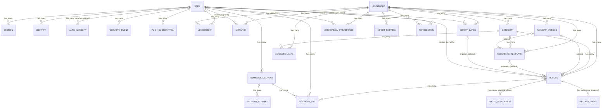

# Household Expense Tracker (家庭支出) — PRD, Architecture, Orchestration & Tracking

## Context
The owner's household tracks bills in a Google Sheet. Its columns are: ✅ done, Type (Expense / Maintenance / Tax), year, month period (1月-2月, 全年, 7月), item, detail, Required, Paid, Finished Date, and a note holding the payment method (玉山ubear, 全支付(玉山帳戶), …) or "Next Time: …" for maintenance. The orange header shows totals per type. The sheet has no reminders, no mobile entry, and no structure for payment methods, periods or attachments; photos live in separate tabs.

**Goal:** a shared, installable web app (PWA) that replaces the sheet on desktop and Android. It records Expense, Maintenance and Tax items with required vs paid amounts, payment date, payment method and notes, filters by year/month/type, reminds members before things are due, and imports the existing sheet history.

Project folder: `~/HouseHold_Notification` (empty, greenfield).

## Decisions (confirmed with user)
| Topic | Decision |
|---|---|
| Platforms | **Rails 8 PWA**: desktop browsers + **Android** (Chrome, installed PWA). **No iPhone/iOS support** (no iOS testing, no iOS push). A native Android shell is **deferred to v2**, only if Web Push proves unreliable (see Appendix) |
| Stack | **Ruby on Rails 8 + PostgreSQL** on the user's existing **Railway** project |
| Users | Shared household, 3 roles: **owner**, **co-owner** (can create/edit/delete records), **viewer** (read-only) |
| Sign-in | **Email + password** (Rails 8 built-in auth, email confirmation required) and **Google**. No LINE sign-in |
| Time zone | Detected from the browser at sign-up (`Intl.DateTimeFormat().resolvedOptions().timeZone`) and stored on the user. **The user's zone is the only time zone**: every business date (today, overdue, mark-paid date, reminder day) and every timestamp uses the zone of the user it's for. Households have **no** time zone setting. Server jobs with no viewer (recurring generation) use the **household owner's** zone. DB in UTC |
| Language | zh-TW + English |
| Currency | **TWD by default** per record; user can switch a record to USD. Totals separate per currency |
| Payment methods | Household-managed list (create/rename/archive) + free-text note per record |
| Period | Year + start month + end month (presets: single month, 雙月, 全年) |
| Recurring | Templates auto-create upcoming unpaid records |
| Reminders | **Web Push** (PWA), email, in-app Upcoming/Overdue. **No LINE** (dropped by user) |
| Email delivery | **Gmail API** (HTTPS) from a dedicated household Gmail account. No Resend, no SMTP, **no custom domain needed for email** (see Architecture → Email via Gmail API) |
| Account deletion | In scope for v1: in-app + public URL, with ownership transfer |
| v1 extras | Google Sheet import, photo attachments, dashboard & charts |
| Charts | **Apache ECharts** (via Stimulus) with click-to-drill-down into the raw records |
| File storage | **Active Storage `Disk` service on a Railway Volume** mounted on the web service. No Cloudflare R2 or other external object storage. Photos are served only through a membership-checked controller. Moving to S3-compatible storage later is a `Mirror`-service migration (see `adr/0004-storage-volume.md`) |
| Deferred to v2 | Native Android shell, 保養記錄, 電池更換紀錄, currency conversion, budgets, OCR, bank sync |

## Diagrams

### 1. System overview
```
 ┌──────────────────────────┐            ┌──────────────────────────┐
 │ Desktop browser          │            │ Android phone            │
 │ (Chrome / Edge / Firefox)│            │ installed PWA (Chrome)   │
 └────────────┬─────────────┘            └─────────┬────────▲───────┘
              │ HTTPS · session cookie (1 yr, sliding)    │ Web Push
              ▼                                    ▼        │
 ┌──────────────────────────── Railway project ────────────┼───────────┐
 │  Rails 8 web service (1 replica)                         │           │
 │   ├─ Hotwire UI · ECharts dashboard · PWA service worker │           │
 │   ├─ Auth: email+password (confirmed) · Google OAuth     │           │
 │   ├─ /h/:household_id/…  → HouseholdScoped + Pundit (404 to others) │
 │   ├─ Sheet import: preview → commit (all-or-nothing)     │           │
 │   ├─ Solid Queue (in Puma): reminders hourly · generation daily ·  │
 │   │    push receipts · cleanup · backup weekly           │           │
 │   └─ Reminders::Dispatcher → Email │ WebPush ────────────┘ │ InApp   │
 │          │ Active Storage (Disk)                                     │
 │          ▼                                                           │
 │  Railway Volume /rails/storage  (sanitized photos, pg_dump copies)   │
 │  PostgreSQL  (app data + Solid Queue/Cache/Cable)                    │
 └──────────────────────────────────────────────────────────────────────┘
        │              │                 │                    │
        ▼              ▼                 ▼                    ▼
    Gmail API     Google OAuth     Push services (FCM)   Sentry · Healthchecks.io
   (household      (sign-in,        (delivers to the      (errors, missed-run
    sender)                          Android PWA)          alerts to the owner)
```

### 2. Core data model
```
 User ──< Membership (owner │ co_owner │ viewer) >── Household
   │                                                   │
   │ sessions · identities · push_subscriptions         ├── Invitation (expiry: 7d/30d/custom/never)
   │ notification_preferences · notifications           ├── Category ──< CategoryAlias
   │                                                   ├── PaymentMethod
   │                                                   ├── RecurringTemplate
   │                                                   ├── ImportBatch ──< ImportBatchChange
   │                                                   ├── ImportKey (every sheet ID ever used)
   │                                                   └── Record  (#record_no · import_key)
   │                                                         ├── photos (Volume)
   │                                                         ├── reminder_snoozes (per member)
   └──────────── reminder_deliveries ──< delivery_attempts ├── reminder_logs ──> reminder_delivery
                                                             └── record_events (kept after delete)
```

### 3. Sheet import flow
```
 Google Sheet 記錄 (+ ID column) ──export──▶ CSV
   │
   ▼  Parse   NT$1,234 → 1234 · dates · 12月–1月 → end year +1 · ID present?
   ▼  Map     item → category (aliases, 電費 variants merged) · ✅ rule (Paid = Required + Finished Date)
   │          牌照稅/保險 need details · maintenance chains by (category, room)
   ▼  Classify by ID only
   │     New │ Update (3-way: last import / app / sheet → ⚠ only if both changed) │ Unchanged
   │     New ID (reused / repeated ID → next unused ID, paste-back list) │ Deleted in app (Skip / Re-create)
   ▼  Validate every row  (Record#valid?(:import))
   │     any error? ── yes ──▶ pop-up 「匯入失敗」 · nothing saved · fix sheet, re-upload
   ▼  Preview modal: tabs (New · Update · Unchanged · New IDs · Chains · Categories · Warnings · Errors)
   ▼  Continue → commit in ONE transaction (create!/save!, lock_version)
         any failure? ── yes ──▶ roll back everything · pop-up 「匯入中止」 names row · ID · field
         no ──▶ import_batch + record_events · Undo = latest batch only, all-or-nothing
```

### 4. Reminder timeline (record with due date D, lead days 3)
```
   D−3          D            D+3   D+6   …   D+30          D+33
 ───●───────────●─────────────●─────●───────────●─────────────●──────▶ stop
  due soon    due date        overdue: every 3 days, max 10    final notice
                                                               ("reminders stopped";
  paid (✅) at any point → stop                                  owner/co-owner can Restart)
  Snooze (per member): 3d · 1w · 2w · until date (≤60d) → skipped, counts toward the 10
  Maintenance next-due (N) and no-due-date repeats follow the same snooze rules
```

### 5. Reminder delivery & failure handling
```
 Hourly job ─▶ for each member at their local reminder hour ─▶ one digest per household × channel
                                                                   │  reminder_deliveries (pending)
             ┌─────────────────────────────────────────────────────┴───────────────┐
             ▼                                                                     ▼
        Web Push → every device                                               Email → Gmail API
        SW shows notification + POST receipt                                  accepted → sent
        ≥1 device receipt → sent                                              API error → failed
        all rejected / no device / no receipt in 24h → failed
             └──────────────────────────────┬──────────────────────────────────────┘
                                            ▼ failed
                       Owner summary (in-app + the other channel): "媽媽 didn't receive …"
                                            ▼
                     Household → 提醒送達狀態 page → Resend (same channel or switch channel)
```

### 6. Milestone order
```
 M0 Foundations ─▶ M1 Auth & household ─▶ M2 Records + Import ─▶ M4 Recurring + reminders ─▶ M5 PWA + Web Push
  push spike        dry-run #2 (0 errors)   backups + restore      cadence, digests, heartbeat    receipts, owner resend
  dry-run #1                                drill before import          │
                                                                         ▼ sheet cutover (app becomes source of truth)
                                                     M3 Photos ─▶ M6 Dashboard (ECharts) ─▶ M7 Release
```

## Scope (v1)

1. **Records** (Expense / Maintenance / Tax, identical fields): category, title, details, period (year + start/end month, may cross a year), currency (default TWD), required amount, paid amount, due date, paid (finished) date, payment method, payment note, next-due date, photos.
   - Status is derived: `unpaid`, `partial`, `paid`, `overdue`. Amounts are optional. **Status rules** (checked in this order; "today" = the viewer's or recipient's local date):
     | # | Condition | Status |
     |---|---|---|
     | 1 | **Expense / Tax:** `paid_on` present **and** `amount_required` present **and** `amount_paid` **=** `amount_required`. **Maintenance:** `paid_on` (finished date) present and (`amount_required` blank, or `amount_paid` = `amount_required`) | `paid` → shown as **✅** |
     | 2 | `due_on` present and `due_on` < today | `overdue` (for both unpaid and partially paid records; the list also shows the amount paid so far) |
     | 3 | `paid_on` present and `amount_paid` < `amount_required` | `partial` |
     | 4 | otherwise | `unpaid` |
     - **✅ / ❌ column (mirrors the sheet):** the list shows **✅ only when the status is `paid`**. Everything else is **❌**: unpaid, overdue, partial (paid < required), or a missing finished date. For Expense and Tax, ✅ therefore always means: Paid and Finished Date are filled and Paid equals Required.
     - **Stored `settled` flag (one definition of "unpaid"):** rule 1 doesn't depend on today, so it is stored as `records.settled boolean not null default false` and set in `before_save` from rule 1. Every write path (form, mark-paid, import create/update, template changes, undo) goes through `save!`, so the flag can't be bypassed; CI greps for `update_all` / `update_column(s)` on records.
       - **`settled = false` is the only definition of "unpaid"** used by reminders, Upcoming, Outstanding, list status filters and partial indexes. A partially paid bill (`paid_on` set, Paid < Required) is `settled = false`, so it still gets reminders.
       - Only `overdue` (`settled = false AND due_on < :today`) is computed at query time, with the viewer's (or recipient's) local date bound as a parameter, so status filters and paging run in SQL.
     - **Validations:** `amount_paid` > 0 requires `paid_on` (a payment needs a date). **`amount_paid` can't exceed `amount_required`** (an error, not a ✅; put fees into Required). For **Expense / Tax**, `paid_on` requires both `amount_required` and `amount_paid`. `paid_on` with `amount_required` present requires `amount_paid` (the import never fills it; a missing Paid is an import error). `paid_on` is the date of the **latest** payment and `amount_paid` the **cumulative** amount paid. A record holds one running total, not a list of installments (installment history is out of scope for v1).
     - **Reminders stop when the status becomes `paid`**, not when `paid_on` is set, so a partially paid bill keeps its cadence.
     - **Spend timing for partial payments:** the full cumulative `amount_paid` counts in the month of the latest `paid_on`. Accepted simplification.
   - **`overdue` requires a `due_on`.** A record with no `due_on` can be `unpaid` or `partial` but **never** `overdue`. The list and Upcoming page show a "未設定到期日 / No due date" chip.
   - **Records with no `due_on` get a reminder choice** (the field shows only when the due date is blank):
     | Option | Behavior |
     |---|---|
     | **不提醒 / No reminder** (default) | No reminders; the record only appears in the Upcoming page's "No due date" section |
     | **Every day** / **Every 3 days** / **Every week** / **Every 2 weeks** / **Every month** | Repeats until the record is paid (or, for Maintenance, marked finished) |
     - **Start date:** "Start reminding on" defaults to tomorrow. Monthly repeats use the same day of month, clamped to month end (31 → 30/28).
     - **Stops** automatically when the record's status becomes `paid` (for Maintenance: finished), the record is deleted, or a `due_on` is added. Adding a due date switches the record to normal due-date reminders, and the repeat setting is cleared.
     - The setting is per record and applies to all members who have that channel enabled. Owners and co-owners can edit it; viewers can't.
     - **Imported rows:** unpaid rows without a due date default to "No reminder". The import preview offers a bulk "set reminder for unpaid rows without due date" choice.
     - **Recurring templates without a `due_day`:** they carry a default reminder frequency, which is copied onto generated records.
2. **Records list:** filters for year, month (period overlap), type, category, status, payment method, and search. A summary bar shows per-type and overall **Required / Paid / Outstanding per currency** for the rows shown, mirroring the sheet header (see Business rules). One-tap "mark paid": sets `paid_on` = the actor's local today and, if `amount_paid` is blank or below `amount_required`, sets `amount_paid` = `amount_required`. If `amount_required` is blank (e.g. a utility bill generated before its amount is known), mark-paid opens a small form asking for the bill amount, which sets **both** `amount_required` and `amount_paid`, so the record becomes ✅ (the amount is optional only for Maintenance). Partial payments are recorded through the edit form.
3. **Categories:** seeded per type, editable, with bilingual names.
   - Expense: 水費, 電費, 瓦斯費, 社區管理費, 保險, 網路/電信, 其他
   - Maintenance: 冷氣清洗, 濾網/濾芯更換, 維修, 其他
   - Tax: 房屋稅, 地價稅, 牌照稅 (detail required: 車牌號碼), 其他
   - 保險 (Expense) requires a detail: 保單號碼或標的. Several scooters or policies = several records in the same category, told apart by `details`.
4. **Payment methods:** CRUD + archive (card / bank / e-wallet / cash / other).
5. **Recurring templates:** e.g. 水/電/瓦斯 every 2 months, 管理費 and 房屋稅 yearly, 冷氣清洗 every 6 months. Each template creates the next unpaid record `lead_days` ahead.
   - **Idempotent, catch-up generation:** for each template, the daily job finds every period starting on or after the template's `starts_on` (default: its creation date, so no back-fill of history) whose generation date (period start, or the due date when `due_day` is set, minus the template's `lead_days`) is ≤ the owner's local today and that has no record yet, and creates it. A missed run (deploy, outage) is caught up by the next one. The unique index on (recurring_template_id, period_year, period_start_month) makes a double run harmless (`RecordNotUnique` → skip).
   - **No duplicates of imported or hand-entered bills:** before creating, the job looks for a record in the same household with the same record_type, category, **details** and period and no template (so scooter A's template never links scooter B's 牌照稅). If **exactly one** exists, it links that record to the template (`recurring_template_id`) instead of creating a new one. If **more than one** matches (e.g. two 電費 meters billed for the same period with an empty Detailed), it links **none** and creates nothing for that period. The template page then shows "2 筆帳單符合 2026 11月-12月，請選擇 / 2 bills match 2026 11月-12月: pick one", and an owner or co-owner picks which one to link (or "create a new bill"). A template therefore never silently claims another meter's bill.
   - **Amounts:** generated records get `amount_required` = `default_amount` only when the template is `amount_fixed` (e.g. 管理費, 房屋稅). For variable bills (水/電/瓦斯), `amount_required` stays blank and `default_amount` is shown as a hint ("上次約 / last time ≈ 580"), so Outstanding isn't distorted by guesses.
   - The template's `lead_days` (how early to generate) is separate from the household's `reminder_lead_days` (how early to remind).
   - **Changing a template's amount or interval updates its existing unpaid bills (latest change wins):**
     - "Unpaid generated bills" here means **untouched** unpaid bills: records with this `recurring_template_id`, `settled = false`, no `paid_on` and no `amount_paid`. This is deliberately narrower than `settled = false`: paid (✅) and partially paid records are **never** touched.
     - **Amount** (for `amount_fixed` templates): every unpaid generated bill gets `amount_required` = the new amount, **even if someone edited that bill by hand earlier**, because the template change is the latest update. For variable templates the amount is only a hint, so the hint updates and bills are untouched.
     - **Interval / period span / due day:**
       - The unpaid bill for the **current** period (already started) is updated in place: its period end follows the new span, and its due date follows the due day.
       - Unpaid bills for periods **not yet started** are deleted and regenerated under the new schedule by the generation job, run right after saving. Bills with photos are updated in place instead of deleted.
     - Before saving, a confirmation lists every affected bill with before → after ("2026 11月-12月 管理費: 4,064 → 4,200"). Saving applies the template change and all bill updates in **one transaction** (all-or-nothing), writing a `template_updated` `record_events` entry per bill. Due-date reminders recalculate from the new dates.
   - **Deactivate = delete:** there is no separate inactive state. Deleting a template removes **only the template**. Every bill it generated, paid or unpaid, is **kept**, unlinked (`recurring_template_id` → null), and keeps its reminders. The confirmation says so. No new bills are generated afterwards.
6. **Reminders:** an hourly job sends at each member's preferred local hour (default 08:00). It covers due-soon, overdue, Maintenance next-due, and **repeating reminders for unpaid records with no due date** (per the record's chosen frequency, evaluated on the recipient's local date), across each member's enabled channels (Web Push / email), deduplicated by `reminder_logs`. There is also an in-app Upcoming/Overdue page.
   - **One digest per member, per household, per channel, per local day:** the run at (or first after) the member's reminder hour gathers every stage due for that member (across records) into a single message.
     - **Late additions wait for tomorrow.** Once today's digest exists for that member × household × channel (a `reminder_deliveries` row with `run_on` = their local today), stages that become due later that day are **not** sent in another digest. Examples: a record created at 14:00 inside its due-soon window, a bill a template generates, a re-dated bill, or chains an import kept. They go out at tomorrow's reminder hour through the normal catch-up (and the "only the latest stage" rule).
     - **Exception:** a record whose `due_on` is **today or already past**, and that has never reminded this member (no `reminder_logs` row for this record and member), is sent at the next hourly run, because waiting would make it overdue before anyone hears of it. At most one such extra digest per member, household and channel per day.
     - Resends and the owner's failure summary aren't digests, so this rule doesn't apply to them. Push: "Household: 3 筆帳單需要處理 / 3 bills need attention", opening the Upcoming page (or the record itself when there's only one item). Email: each item with its stage, amount and link. The cadence below is still computed and logged per record and stage; only delivery is batched.
   - **Delivery state (claim → dispatch → settle):** for each (record, stage, scheduled_on, channel) the job first inserts a `reminder_logs` row (the **claim**). The unique index acts as the lock: a `RecordNotUnique` means another run already owns it. Only when at least one row was claimed for a member × household × channel does the job create the `reminder_deliveries` row (`status: pending`) and point the claimed logs at it, so a double run never creates an empty delivery.
     - **The delivery's status is the only status.** `reminder_logs` carry no status of their own (no copied column that can drift). Delivery states:
       - `pending`: claimed, not yet handed to the channel (`dispatched_at` null).
       - `awaiting_receipt` (**Web Push only**): accepted (201) by at least one push service, waiting for a device receipt. Becomes `sent` on the first receipt, or `failed` after 24h (`ConfirmPushReceiptsJob`).
       - `sent` / `failed` / `resolved`: settled.
     - Delivery jobs retry transient errors 3 times with backoff. A final failure marks the delivery `failed` and reports to Sentry (heartbeat rules: see Architecture → Monitoring).
     - **Crash recovery applies only to `pending` deliveries with `dispatched_at` null that are older than 2 hours** (the run died between claim and dispatch). The next run dispatches them. A delivery in `awaiting_receipt` is **never** re-dispatched by the reminder job, so a push waiting for its receipt isn't re-sent every hour; only the owner's Resend sends it again.
     - A `failed` row counts as handled for dedupe, so fixing a broken channel never releases a flood of old reminders. Failures are surfaced to the owner (below), who can resend them.
   - **Delivery status is stored per channel**, as one `reminder_deliveries` row per digest (member × household × channel × run). Its `reminder_logs` point to it, and per-device results go in `delivery_attempts`.
     - **Web Push = "sent" when at least one of the member's devices received it.** "Received" means the device itself confirmed it: the service worker's `push` handler shows the notification, then POSTs a receipt (`/push_receipts/:token`, `fetch(..., {keepalive: true})`; the one-time token is in the payload). The push service's 201 alone only means "accepted by Google/Mozilla", so it is recorded as `accepted` on the attempt, not as received.
       - Each device gets one `delivery_attempts` row (`accepted`, `rejected` with the HTTP status, `received`).
       - While waiting, the delivery is `awaiting_receipt`. It becomes **`sent` on the first device receipt**.
       - It becomes **`failed`** if every device is rejected, if the member has **no** active subscription, or if **no device confirms within 24 hours** (the push TTL; Android may hold pushes while a phone sleeps).
         - The first two are known at dispatch (**synchronous failures**).
         - The 24-hour case is known only a day later (**asynchronous failure**). The `ConfirmPushReceiptsJob` (hourly) settles it.
       - `/push_receipts/:token` is unauthenticated (the session may have expired, which is allowed) and CSRF-exempt; the single-use token is the only credential. It is rate-limited.
     - **Email = "sent" when the Gmail API accepts the message.** Inbox receipt can't be confirmed (no read receipts or bounce processing in v1); this is stated in NOTIFICATIONS.md. It is `failed` on a final API error (e.g. `invalid_grant`, invalid address).
     - The in-app inbox always receives the digest and has no failure state.
   - **Owner is told who didn't receive a reminder:**
     - Failures are batched into **one daily summary per household**, not one per run or per failure. Push failures settle up to 24h after sending, in whichever hourly `ConfirmPushReceiptsJob` run happens to settle them, so per-run summaries would arrive in fragments at odd hours.
       - The summary is its own job, `OwnerFailureSummaryJob`, **enqueued at the end of every `SendRemindersJob` run**, so it always runs after that hour's email and push dispatch, never before it. Both jobs are hourly, so running the summary from `ConfirmPushReceiptsJob` could fire before the reminder run and miss its failures.
       - When the owner's local hour ≥ their `reminder_hour` and `households.last_failure_summary_on` < the owner's local today, the job collects every `failed` delivery with `owner_notified_at` null. That covers email failures from this morning's run and push failures `ConfirmPushReceiptsJob` has settled since the last summary. It sends **one** summary, sets `owner_notified_at` on each delivery, and sets `last_failure_summary_on`.
       - A resent delivery that fails again gets `owner_notified_at` cleared, so it appears in the next summary.
       - The same step pings the **delivery-health** heartbeat (see Architecture → Monitoring).
     - The **household owner** gets the summary:
       - **in-app**, always;
       - **Web Push and email**, unless that same channel is the one that failed.
       - Example: "提醒未送達：媽媽 (Web Push，沒有裝置確認收到)、爸爸 (Email，Gmail 授權失效) / Reminder not received: Mom (Web Push, no device confirmed), Dad (Email, Gmail authorization expired)", with a link to the delivery status page.
     - **Delivery status page** (Household settings → 提醒送達狀態 / Reminder delivery, **owner only**): lists failed deliveries (newest first) with member, channel, scheduled date, the items in the digest, the reason per device (e.g. "Pixel 7 Chrome: no confirmation in 24h", "subscription expired (410)", "no device has notifications enabled"), attempts, and resend history.
     - **Resend** (per delivery, plus "Resend all failed"):
       - It rebuilds the digest from the items that are **still unpaid** (paid ones are dropped; if none remain, the delivery is marked `resolved` with "nothing left to remind") and sends it again on the **same channel**, creating new `delivery_attempts`, with the receipt rules above.
       - If the channel can't work (Web Push with no active subscription, email while Gmail authorization is broken), Resend is disabled with the reason, and **"Send by email instead"** / **"Send by Web Push instead"** is offered when the other channel is enabled for that member.
       - Rate limit: one resend per delivery per 10 minutes. It records `resent_by_id` / `resent_at`, and a later success flips the delivery to `sent`, with the failure kept in its history.
     - A permanently failing member (e.g. failed 3 runs in a row on Web Push) is highlighted on the page with a hint: "ask them to open the app and tap 'Enable notifications' on their phone".
   - **Viewers** get reminders only if they turn a channel on: their notification preferences default to off. Owners and co-owners default to on.
   - **Cadence for records with a due date** (D = `due_on`; all dates are the recipient's local dates):
     | Stage | Sends on | Example (D = Oct 20, lead days 3) |
     |---|---|---|
     | Due soon | **D − lead_days**, once (lead days = the household's `reminder_lead_days`, default **3**, set by the owner) | Oct 17 |
     | Due date | **D**, once | Oct 20 |
     | Overdue | **D + 3, D + 6, …, D + 30**: every 3 days, **at most 10 overdue reminders** | Oct 23, 26, 29, … Nov 19 |
     | Final notice | **D + 33**, once: "已逾期 33 天，之後不再提醒 / Still unpaid after 33 days; reminders stop now" | Nov 22 |
     - **Stops** when the record's status becomes `paid` (or Maintenance is marked finished), when it is deleted, or **after the final notice (cap)**. A partial payment does not stop it. No reminders on the days in between.
     - **After the cap**, the record stays `overdue` (❌) in the list and in the Upcoming page's "逾期 / Overdue" section, with a "提醒已停止 / reminders stopped" chip. Owners and co-owners can tap **"重新提醒 / Restart reminders"**, which starts a new cycle of 10 overdue reminders from the next run (logged in `record_events`). Changing the due date also starts a fresh schedule.
   - **Snooze (per member):** every reminder (push and email link), the Upcoming page and the record page offer **"稍後提醒 / Snooze"**: **3 days**, **1 week**, **2 weeks**, or **until a date** (max 60 days).
     - A snooze is **personal**: it silences that record for **that member only**, on all channels. Other members keep their reminders. Viewers can snooze too.
     - While snoozed, scheduled sends are skipped and logged as `snoozed` (not caught up later). On the snooze end date the member gets one "snooze ended" reminder if the record is still unpaid, then the normal cadence resumes.
     - Snoozed overdue sends still count toward the 10-reminder cap, so a snooze can't push the cap later than D + 33.
     - Paying the record clears all snoozes. The record page shows "你已延後到 11/05 / You snoozed until Nov 5" with **Cancel snooze**.
     - Snooze applies to all reminder kinds (due-date, next-due, no-due-date repeats).
     - **Due date changed:** the schedule is recalculated from the new date. Past sends aren't repeated, but a new due-soon or due-date send can happen if its date is still ahead.
     - **Lead days = 0:** only the due-date and overdue reminders are sent.
     - **Catch-up:** each run sends a stage when its **most recent scheduled date ≤ today** and no `reminder_logs` row exists for that scheduled date. A record created inside its due-soon window (e.g. due in 2 days) therefore gets its due-soon reminder on the next run. A day missed by downtime is sent on the next run.
       - **Only the latest stage is sent.** For each record and recipient, a run considers every stage whose most recent scheduled date ≤ today and sends **only the latest** (order: due soon < due date < overdue; for Maintenance, next_due_soon < next_due_today < next_due_overdue). Earlier unsent stages are superseded: they aren't sent and get no log row. So if the job is down from D through D+3, the D+3 run sends only the overdue reminder, not "due today" as well. Once the due date has arrived, a missed due-soon is not sent.
       - **Wording comes from today, not from the stage.** The digest text is computed from `today − due_on`, and the stage only decides whether and when to send. A due-date reminder delivered on D+1 because D was missed reads "已逾期 1 天 / 1 day overdue", not "due today". The cadence is unchanged: the next send is still D+3.
     - **Send hour:** a member is processed when their local hour **≥** `reminder_hour` and nothing for that scheduled date has been sent yet. Once today's digest has gone out, later runs that day send only the due-today exception (see "One digest per member … per local day"). A run that misses the exact hour (deploy, restart, DST gap) still sends later that day.
     - `Reminders::Schedule.scheduled_on(record, stage, local_date, lead_days:)` computes these dates and is shared with the no-due-date frequencies. It returns the most recent scheduled date ≤ `local_date` for that stage (or nil). `Reminders::Schedule.current_stage(record, local_date, lead_days:)` returns the **latest** stage with a non-nil date and that date (or nil), and the job sends when no `reminder_logs` row exists for it. `lead_days` is passed from `household.reminder_lead_days`.
     - **Lead days setting:** stored on `households.reminder_lead_days` (integer, default **3**, allowed 0–30). Only the **owner** can change it, in Household settings. It applies to every member of the household. Changing it recalculates the due-soon date like a due-date change: a new due-soon send can happen if its date is still ahead.
   - **Maintenance next-due (`next_due_on`) follows the same cadence**, with N = `next_due_on`: **N − lead_days**, then **N**, then **N + 3 … N + 30** (at most 10), then a final notice at **N + 33**, with the same snooze and restart rules. The same catch-up, send-hour and date-change rules apply. Log kinds: `next_due_soon`, `next_due_today`, `next_due_overdue`.
     - The record itself is usually already finished (it has a `paid_on`), so "stops when paid" doesn't apply. Next-due reminders stop when:
       1. **"完成 / Done"** is tapped on the reminder, the Upcoming page or the record. This opens a prefilled new Maintenance record (same category, title, **details (room/area)** and payment method, so the new record stays in the **same chain**; finished date = the actor's local today; asks for the next `next_due_on`). Saving it clears `next_due_on` on the old record, so the chain continues from the new record.
       2. `next_due_on` is cleared or moved by editing the record (moving it recalculates the schedule).
       3. The record is deleted.
     - **No double reminders with templates:** a next-due reminder is suppressed while an unpaid record in the same household, category **and chain (same normalized details / room)** has a `due_on` within ±30 days of N (the bedroom AC's template bill never silences the living-room AC's next-due reminder) (e.g. a 冷氣清洗 record generated by a template). That record's own due-date cadence covers it.
7. **Attachments:** take/pick photos, stored privately per household.
   - **Storage:** Active Storage `Disk` service with `root: /rails/storage`, a path backed by a **Railway Volume** attached to the web service. Without the volume, files would be lost on every deploy, because the container filesystem is ephemeral.
   - **Private by construction:** `config.active_storage.draw_routes = false`, so none of the public-by-link `/rails/active_storage/...` blob, proxy, variant or direct-upload routes exist.
     - Photos are served by `PhotosController#show` at `/h/:household_id/records/:record_id/photos/:id(/:variant)`. It runs through `HouseholdScoped` + Pundit, checks the attachment belongs to that record and household, and streams the file with `send_blob_stream` (`ActiveStorage::Streaming`).
     - Response headers: `Cache-Control: private, max-age=300`, `Content-Disposition: inline`, `X-Content-Type-Options: nosniff`.
   - **Uploads:** plain multipart form posts to `PhotosController#create` (owner/co-owner only, Pundit). No direct uploads, so no CORS and no unauthenticated upload endpoint.
     - Validation: `image/jpeg`, `image/png`, `image/webp`, `image/heic`; max **10 MB** per file; max **10 photos** per record.
     - **Sanitize synchronously, before attaching:** `PhotosController#create` validates type/size, then runs `Photos::Sanitizer` (ruby-vips via `image_processing`) on the uploaded tempfile:
       - auto-rotate from the EXIF orientation;
       - **strip all metadata** (EXIF, GPS, XMP, ICC → sRGB);
       - downscale to ≤2000px on the long edge;
       - re-encode to JPEG (q≈82); HEIC is converted to JPEG too.

       Only then is the **clean file** attached (`record.photos.attach(io: clean, filename:, content_type: "image/jpeg")`). The original upload is never written to the volume, so there is no window where a GPS-tagged file exists on disk or can be served, and no background job is needed. vips takes well under a second for a ~5 MB photo.
     - The Docker image needs `libvips` (already in the Rails Dockerfile) **plus `libheif1`** for HEIC input, and the `ruby-vips` gem (`image_processing` 2.x no longer pulls it in). On Debian bookworm `libheif1` links the HEVC decoder (`libde265`) directly; newer Debian releases split it into `libheif-plugin-libde265`, which the Dockerfile installs when it exists. M0 check X5 verified HEIC → JPEG in the built image (ADR 0005); M3 verifies again with the sanitizer and the HEIC fixture in CI and on Railway.
     - If sanitizing fails (corrupt or unsupported image), the upload is rejected with a validation error and nothing is attached.
     - **Client-side downscale first:** a Stimulus `photo_upload` controller resizes each picked or captured image to ≤2000px JPEG with a canvas before upload. Full-size photos from high-resolution Android cameras (often 10–20 MB) then fit the 10 MB limit and upload quickly on mobile data. If JS or canvas decoding fails (e.g. HEIC on some devices), the original file is sent. The server sanitizer stays the authority: it still strips metadata and re-encodes.
     - Uploads are processed one file at a time to cap memory. The vips `access: :sequential` mode keeps memory low.
     - Thumbnails come from Active Storage variants (libvips in the Docker image), generated on the volume.
   - **Deletion:** removing a photo, a record or a household purges the blob and its variants from disk (`purge_later`).
   - **Avatars** (My Account) use the same volume, and with the default routes disabled they're served by `AvatarsController#show`. The avatar is visible only to the user and members of households they share. It goes through the same synchronous `Photos::Sanitizer` (square-cropped to 512px) before attaching, and is purged on account deletion.
8. **Dashboard (Apache ECharts, interactive):**
   - **Charts:**
     - Monthly spend stacked by type (bar).
     - Utility trends 水/電/瓦斯 (line).
     - Totals by category and by payment method (bar/pie).
     - **Box plot** of bill amounts per category (spread, median, outliers; e.g. 電費 by billing period).
     - Unpaid/overdue count.
   - **Filters:** year, currency (charts never mix TWD and USD), type.
   - **Click to drill down:** every chart element is clickable, using `chart.on('click', params => …)` in a Stimulus `chart_controller`.
     - Each data point carries its filter keys in the series data (e.g. `{value, filters: {category_id, year, month, record_type, currency}}`).
     - On click, the controller loads `GET /dashboard/drilldown?…` into a Turbo Frame below the chart. The frame shows the **raw records** behind that element in a table (period, title, required, paid, paid date, payment method, note), with totals and links to each record.
     - **Box plot:** clicking a box shows all records in that category/period group, sorted by amount and with quartile markers. Clicking an **outlier dot** (scatter series) opens that single record directly, because outlier points carry the `record_id`.
     - The drilldown endpoint reuses the same `DashboardQuery` scopes as the chart, so the table always matches the clicked number, and it is tenant-scoped and Pundit-authorized.
   - responsive resize; each chart has a "view as table" toggle for accessibility. (The ECharts zh-TW locale and a dark-mode theme were dropped for v1 on 2026-10-19: the charts use no ECharts built-in text, and the app has no dark mode.)
   - ECharts is loaded via importmap as **one vendored, pinned file**: a custom build containing only bar, line, pie, boxplot and scatter. Importmap can't tree-shake, so the modular `echarts/core` imports aren't used (M0 check X6).
9. **Google Sheet import (ships in M2, with records core):** CSV of the 記錄 tab → auto-map → preview with warnings → commit.
   - **`ID` column is required (one-time sheet change before the real import):**
     - Add an `ID` column to the 記錄 tab and fill it once with unique, never-reused values: e.g. type `1` in the first row, fill down, then **paste as values** so the IDs don't move when rows are inserted or sorted. Every new sheet row gets the next number.
     - A CSV **without** an `ID` column, or with a blank ID, is **rejected** before the preview, with a notification listing the rows and linking to a short "how to add the ID column" help page. Nothing is imported.
   - **Every ID is unique and never reused:**
     - **App record numbers:** every record gets its own household-unique number **#N** (`records.record_no`, from a locked per-household counter `households.next_record_no`). It's shown on the record and in exports, and **never reused**, even after deletion.
     - **Sheet IDs are retired once used:** every sheet ID ever imported is kept in **`import_keys`** (household, key, record_id, status `active|retired`), even after its record is deleted (status → `retired`). A used ID is never attached to a different record.
     - **IDs are positive integers.** After trimming, the ID must be a whole number (`87`, or `87.0` as Sheets sometimes exports it). Anything else (`A-12`, `87a`) → error. This keeps "the next unused ID" well defined.
     - **Duplicate ID in the file:** a row whose ID **appears twice** in the file (the second and later rows) is **not** rejected. The preview **assigns it the next unused ID** (one above the highest key ever used in the household or the file), and lists it in a **"新 ID / New IDs" tab**: "row 120: ID 87 is already used → new ID 431".
     - **Retired ID (its record was deleted in the app):** one rule tells "the deleted bill's row is still in the sheet" apart from "someone reused the number for a new bill". When a key is retired, `import_keys.retired_digest` stores the deleted record's last `import_digest`. On import:
       - the row's mapped values **equal** `retired_digest` → **deleted in the app** (default **Skip**; option **Re-create** with a new ID);
       - the values **differ** → **ID reused** (default **Import as new** with a new ID; option **Skip**).
       - The tab shows the deleted record's snapshot (from its `deleted` record event) next to the row, so the user can tell which case it is. Either way, the old ID is never attached to a different record.
     - **"IDs to paste back":** a downloadable/copyable list (sheet row → new ID) so the sheet can be updated. Until the sheet shows the new ID, later imports recognize the row: the reassignment is stored in `import_keys` (`source_key` = the old sheet ID, `source_row_digest` = a hash of that row's mapped values at assignment time), so a row still carrying the old ID with matching values maps to the reassigned record (unchanged/update), never a second copy. This is only for recognizing the same sheet row until its new ID is pasted back; it is not duplicate detection. A warning repeats "sheet still shows ID 87 for row 120; paste 431".
       - **A pending row that changed in the sheet is an error, not another new ID.** Suppose a row still carries the old ID, matches no `source_row_digest`, and that old ID has an unresolved reassignment (`pasted_back_at` null). This is an **error**: "ID 87 的列有待貼回的新 ID 431，請先貼回再匯入 / the row with ID 87 has a pending new ID 431; paste it back first". Otherwise, editing the row before pasting (e.g. adding the paid date) would mint a second new ID and a duplicate record.
       - When an import sees a row carrying the new ID (431), `pasted_back_at` is set and old-ID matching for it stops.
       - The import page shows a **pending paste-backs** count, and every import repeats the list until it reaches zero.
     - `records.import_key` = the sheet ID (trimmed string), unique per household. Row numbers appear only in messages ("row 87").
     - **Identity is the ID only. Rows with different IDs are always different records**, even if every other field is identical (two scooters' 牌照稅, two 冷氣清洗 visits in the same month). There is **no content-based duplicate detection** (no `content_key`, no look-alike matching).
   - **Preview classifies every row:**
     | Case | Default action | User options |
     |---|---|---|
     | **New:** ID not in the household's `import_keys` | Import | — |
     | **Reason 2a, already imported, unchanged:** ID exists and the mapped content equals the record's `import_digest` | Skip (counted as "unchanged") | — |
     | **Reason 2b, already imported, changed in the sheet:** ID exists and the content differs | **Update** | Per row **Update / Skip**, plus "Update all changed". The diff shows field, current value in the app, and new value from the sheet. |
     | **Repeated ID** (the same ID twice in the file) | Import with a **new ID** (New IDs tab) | — |
     | **Retired ID, same values** (deleted in the app, row still in the sheet) | **Skip** | Re-create with a new ID |
     | **Retired ID, different values** (number reused for a new bill) | Import with a **new ID** | Skip |
     | **Old ID with a pending paste-back, row changed** | **Error** (paste the new ID first) | — |
   - **Updating already-imported rows (reason 2b):**
     - Choosing Update writes the sheet's values into the existing record and **stores the updated content in the database**. Only sheet-mapped fields are written (type, period, title, details, category, amounts, paid date, payment note, next due date); photos, reminder settings and anything not in the sheet are kept.
     - Status is recalculated, so e.g. a paid date added in the sheet makes the record paid and stops its reminders. `import_digest` and `imported_at` are refreshed.
     - **Three-way, per-field comparison.** Each imported record stores `import_snapshot` (jsonb): the sheet-mapped values the import **last wrote** (the base). For every sheet-mapped field the preview compares three values: **base**, the **app's current value**, and the **sheet's new value**.
       | Base → app | Base → sheet | Result for that field |
       |---|---|---|
       | unchanged | unchanged | nothing to do |
       | unchanged | changed | **update** to the sheet value (no flag) |
       | changed | unchanged | **keep** the app value (no flag) |
       | changed | changed, **same** new value | nothing to do (already equal; the snapshot is refreshed) |
       | changed | changed, **different** values | **⚠ conflict**: flagged "App 與試算表都改了 / changed in both the app and the sheet" |
     - Only true conflicts are flagged. For each conflicting field the user picks **Keep app value** (default) or **Use sheet value**. Non-conflicting fields of the same row still update normally. A row with conflicts counts as "Update (N conflicts)" in the summary.
     - Photos, reminder settings and other non-sheet fields are never compared and are never overwritten.
     - After commit, `import_snapshot` is set to the values now stored for the sheet-mapped fields, so the next import uses them as its base.
     - Every update writes an `import_batch_changes` row (before/after JSON) and a `record_events` entry ("the owner updated 2026 5月-6月 電費 from sheet import: amount_paid 5,637 → 5,673").
     - Family members can, of course, also edit any record directly in the app at any time (owner/co-owner); that's normal record editing.
     - **Deleted in the app:** the record is hard-deleted, and its sheet ID becomes **retired**. If the row is still in the sheet, the next import shows it as "deleted in the app on 2026-11-02" (when its values still equal the deleted record's last import; otherwise it's a reused ID, see above): the default is **Skip**, and the option **Re-create** imports it as a new record with a **new** ID (from IDs to paste back). To remove a sheet row for good, delete it from the sheet too.
   - **Preview state (`import_previews`):** building the preview saves an `import_previews` row. It holds the household, user, filename, the parsed and classified rows (jsonb, including errors and warnings), the per-row choices (updated as the user ticks boxes), the `lock_version` of every existing record the preview would update, a SHA-256 of the CSV, `expires_at` (1 hour) and `committed_at`.
     - Continue posts the preview id. Commit loads it (it must belong to the current user and household, be unexpired, and have `committed_at` null), locks the row (`SELECT … FOR UPDATE`) and sets `committed_at` in the same transaction.
     - Each update is applied with the **preview's** `lock_version`, so an in-app edit between preview and commit raises `StaleObjectError`.
     - A double-submit finds `committed_at` already set and is rejected as "already imported".
     - The daily cleanup job deletes expired previews.
   - **Pop-up notification:** when the preview is built, a modal summarizes "新增 X · 更新 Y · 未變更 Z · 新 ID W / New X · Update Y · Unchanged Z · New IDs W". It has tabs per case, with row numbers, the diff for updates, and links to existing records. **Continue** applies the chosen actions; **Cancel** writes nothing. Afterwards a flash summary appears, and a CSV of skipped rows can be downloaded.
   - **Duplicate header columns** (e.g. two `Paid` columns, or an ambiguous mapping) → the whole file is **rejected**, with a notification naming the duplicated column.
   - **Full model validation at preview time:**
     - Every row is mapped into an unsaved model, with **all `Record` validations** run on it (`valid?(:import)`): a `Record.new` for new rows, or `assign_attributes` on the existing record for reason 2b updates. Normalizations run too.
       - Checks include record_type and category present, with the category's type matching. Months are 1–12 and the period end isn't before its start. Currency is TWD/USD. Amounts are ≥ 0 and fit `decimal(12,2)`. Dates are valid. `reminder_frequency` is `none` when `due_on` is present. Category, payment method and template belong to this household.
     - Categories or payment methods the import would create are built and validated the same way, but not saved until commit.
     - Parse failures (an unrecognized month text like `1–2月?`, an unreadable date or amount) and validation errors appear in an **"錯誤 / Errors"** tab. It lists the row number, field and message (in the user's locale), plus the raw cell value.
     - **Any error aborts the import (all-or-nothing):** if even one row has an error, **Continue is disabled** and nothing can be written. The pop-up opens on the Errors tab: "匯入失敗：N 筆資料驗證錯誤，未寫入任何資料 / Import failed: N rows have errors; nothing was saved". The user fixes the rows in the sheet and re-uploads. An errors CSV (row, ID, field, message, raw value) can be downloaded.
     - The modal summary adds the count: "… · 錯誤 E / Errors E".
     - **Warnings** don't block the import. They appear in a "注意 / Warnings" tab: a row ✅ in the sheet that doesn't meet the ✅ rule, imported as ❌ (with the reason: Paid < Required, or Finished Date empty); ✅ unchecked but complete (imported as ✅); and maintenance chain notes (see the Maintenance chains tab). Also warned: two or more rows in the **same category and period with an empty Detailed** (e.g. two 電費 rows for 11月-12月): "可能是不同電錶，請在 Detailed 填入位置 / these may be different meters; add the area in Detailed". They are still imported as separate records, because identity is the ID. The summary adds "· 注意 N / Warnings N".
     - **Acceptance check:** the summary shows the total Required and Paid per currency of everything that will be stored, next to the sheet's header total (300,000), so a mismatch is visible before Continue.
   - **Commit re-validates, then writes:**
     - Between preview and commit, data can change: a category is archived, or a record is edited in the app. So commit runs the same validations again inside the transaction.
     - Rows are written with **`save!` / `create!` per row** (not `insert_all`), so validations, normalizations and callbacks always run. This is fast enough at sheet size (hundreds of rows).
     - **If any row fails at commit** (validation, `RecordNotUnique`, `StaleObjectError`, or anything else), the **whole transaction rolls back**, so **nothing is saved**. A pop-up shows "匯入中止 / Import aborted" with the failing **row number, ID, field and message**, and the preview is rebuilt with that row in the Errors tab.
   - **DB backstop, for races only:** the unique index on (household_id, import_key) and optimistic locking (`lock_version`) on updates guard against a double-submit or a concurrent in-app edit.
     - A `RecordNotUnique` on insert (someone imported the same ID meanwhile) or a `StaleObjectError` on update (edited in the app meanwhile) **aborts the whole batch** like any other failure. There are no savepoints and no partial commits, and the pop-up names the row.
     - These are expected never to fire in normal use, because the preview already classified every row.
   - **All-or-nothing:** the batch is committed in **one transaction**; either every chosen action is applied or none is. The `import_batches` row (written in the same transaction) records created/updated/skipped counts. **Undo** (also all-or-nothing, one transaction) is offered **only for the household's most recent non-undone batch**, so undoing an older batch can never overwrite a later one. It deletes the records the batch created and **restores the before-values** of the records it updated (from `import_batch_changes`). The whole undo is refused (nothing changes; the pop-up lists the records) if any affected record's sheet-mapped fields differ from that batch's `after` values, a created record has since had photos added, or an affected record was deleted. Undo writes `import_undone` `record_events`.
10. **Authentication** (email + password, Google):
    - **Built on the Rails 8 authentication generator only (`bin/rails generate authentication`): no Devise gem.** Confirmation, `unconfirmed_email` and email change are small additions written on top of it, using Rails built-ins (`has_secure_password`, `generates_token_for`, Action Mailer, `rate_limit`).
    - **Verified-only email ownership:**
      - `users.email_address` holds **only a confirmed email** (unique where not null). A pending address lives in `users.unconfirmed_email` (**not unique**), so an unconfirmed sign-up never reserves or blocks an address.
      - The confirmation token (`generates_token_for :email_confirmation`, 24h) embeds the `unconfirmed_email` value, so changing it invalidates old links.
      - On confirmation, the address moves into `email_address` inside a transaction. If someone else has verified it meanwhile, the unique index rejects the move and the user sees "this email is already in use".
    - **Email + password sign-up:**
      - Always responds "Check your email" (no account enumeration).
      - If the address already belongs to a verified account, that inbox instead receives "You already have an account: sign in or reset your password".
      - Password sign-in looks up only `email_address`, so unconfirmed accounts can't sign in. The error is always the generic "invalid email or password".
      - Resend-confirmation and password-reset return the same uniform responses. A password reset is only possible for a verified `email_address`.
    - **Google** (`omniauth-google-oauth2`, scopes `openid email profile`). Resolution rules, all in `Auth::IdentityResolver`:
      1. Identity (google, uid) exists → sign in to its user.
      2. Signed in and clicking "Connect Google" in Settings → link to the current user (OAuth `state` bound to the session).
      3. `email_verified == true` and it matches a user's `email_address` (verified by construction) → link + sign in.
      4. `email_verified != true` → refuse, with "Please verify your Google email first".
      5. No match → create a user with `email_address` = the Google email (verified now).

      Accounts that hold this address only as `unconfirmed_email` lose nothing: they can never confirm it now, and cleanup deletes them.
    - **Cleanup job (daily):** deletes users with `email_address IS NULL`, no identities, and `created_at` older than **7 days**.
    - **Email change:** writes `unconfirmed_email` → confirmation link; the old address is notified.
    - Users can connect/disconnect Google, but never remove their last sign-in method. A Google-only user can set a password through a reset email.
    - **Web OAuth carry-over:** the "Continue with Google" form is a CSRF-protected POST (`omniauth-rails_csrf_protection`) carrying `tz` and an optional `return_to` (internal path only). The server stores them in an `auth_handoffs` row (10-min TTL, single use), and only the handoff id travels in the session. The callback reads them from the row. Invitations do **not** travel through any auth flow; they are found by verified email (see 12a).
    - **Session lifetime: 1 year, sliding.** Each visit extends it, so a family member who opens the app at least once a year never has to sign in again. Sign-out and "sign out other sessions" end sessions immediately (and remove those browsers' push subscriptions); expiry does not remove push subscriptions.
    - Rate limiting (Rails 8 `rate_limit`) on sign-in, sign-up, confirmation resend, password reset and OAuth start. `Referrer-Policy: no-referrer` on auth routes. `filter_parameters` covers `token, invite, password, code`.
11. **Time zone:**
    - A Stimulus `timezone` controller fills a hidden `tz` field on the sign-up and "Continue with Google" forms. The server validates it against tzinfo and falls back to `Asia/Taipei`.
    - The value is stored in `users.time_zone`. An `around_action` wraps each request in `Time.use_zone(Current.user.time_zone)`.
    - Date-only fields (`due_on`, `paid_on`, `next_due_on`, periods) never shift.
    - Settings lets users change it, and a banner appears when the browser zone differs from the saved one.
    - **Time zone rules (single source = user's zone):**
      | Business date | Zone used |
      |---|---|
      | "Today", overdue/due-soon status, Upcoming page, list/dashboard status | The **viewing user's** zone |
      | "Mark paid" → `paid_on` default | The **acting user's** local today |
      | Reminder send hour, `reminder_logs.scheduled_on`, which items are due-soon/overdue in that reminder | The **recipient's** zone (each member evaluated in their own zone) |
      | Recurring generation (`lead_days` ahead), with no viewer | The **household owner's** zone (follows ownership transfer) |
      | Timestamps (created/updated, activity log) | Displayed in the viewing user's zone |
    - `households` has no `time_zone` column. `Household#time_zone` delegates to `owner.time_zone`.
    - **Accepted consequence:** with members in different zones (e.g. Taipei and the US), the same bill can show as overdue for one member a few hours before another. This is intentional, because each person sees dates in their own local terms.
    - Implementation: `Current.time_zone` comes from `Current.user`; jobs wrap each recipient in `Time.use_zone(recipient.time_zone)`; the generation job uses `Time.use_zone(household.time_zone)` (the owner's). There is no `Date.today` anywhere.
12. **Household & roles:**

    | Action | owner | co_owner | viewer |
    |---|---|---|---|
    | View records, photos, dashboard, Upcoming; export CSV | ✅ | ✅ | ✅ |
    | Create/edit/delete/mark-paid records, upload/delete photos | ✅ | ✅ | ❌ |
    | Manage categories, payment methods, templates, import | ✅ | ✅ | ❌ |
    | Edit own account (profile, email, password, language, time zone, notifications, connected Google); delete own account; leave household | ✅ | ✅ | ✅ (owner can't leave; must transfer first) |
    | Edit household (name, default currency, reminder lead days); invite/remove members, change roles, transfer ownership, delete all records, delete household | ✅ | ❌ | ❌ |
    | View reminder delivery status, receive "reminder not received" summaries, resend failed deliveries | ✅ | ❌ | ❌ |

    - **Delete all records (added 2026-10-19, owner only):** Household settings → Danger zone → "刪除所有記錄 / Delete all records", behind re-auth and the typed household name (`Records::PurgeAll`). It deletes every record of the household with its photos, record events, reminders and deliveries, in-app notifications, and the import history (`import_batches`, `import_keys`, previews), so the sheet can be imported again from scratch with every row as new. Kept: the household, members, categories, aliases, payment methods, settings. Recurring templates are deleted too by default; if kept, any `starts_on` before this month moves to the 1st of this month (rhythm unchanged), because catch-up generation would otherwise recreate every past bill. Logged in the household activity as "records_deleted" with the count.
    - **Privacy:** a household belongs to its owner. Nobody else can see that it exists, or any of its data, unless the owner invites them and they accept. Every household URL returns 404 to non-members (§12a).
    - **Invitation expiry is chosen by the owner** when sending: **7 days** (default), **30 days**, **custom** (a date or number of days), or **never expires**. A never-expiring invitation is still single use and revocable, and still requires the verified-email match. The member list shows each pending invitation's expiry ("expires 2026-11-15" / "never expires"), and the owner can revoke it or resend it with a new expiry.
    - **Invitations:** invite by email with a role (co_owner / viewer). Accepting requires a pending, unexpired, unrevoked invitation **and** the signed-in user's verified `email_address` equal to the invited email. Acceptance is always an explicit "Accept / Decline" screen, never silent. Each invitation is single use.
12a. **Household context, onboarding & invitations (multi-household defined):**
    - **Scope decision:** a user may belong to **several households** (e.g. owns their own and is a viewer in a parent's). v1 includes a minimal **household switcher** (header dropdown, shown only when the user has more than one membership). **Out of scope:** cross-household views (combined dashboards, moving records between households).
    - **Creating another household (added 2026-10-19):** a user who already belongs to a household can create a new one from **My account → Households → "＋ 建立新家庭 / Create a new household"**, or from the switcher dropdown's last item. Both open the onboarding page (`/onboarding`), which then shows only the create form ("建立新家庭 / Create a new household"; a new household starts empty, with its own records, members, categories and reminders, and the creator as owner) and hides the "waiting for an invitation" panel. Joining someone else's household is still by invitation only.
    - **How `Current.household` is resolved:** all household data lives under **household-scoped URLs**, `/h/:household_id/...` (records, dashboard, upcoming, templates, settings…).
      - A `HouseholdScoped` concern sets `Current.household = Current.user.households.find(params[:household_id])` and returns 404 if the user isn't a member. The membership (and so the role) is loaded with it for Pundit.
      - Nothing comes from session state, so two tabs on two households never interfere, and every link in emails, push payloads and drill-downs carries its household explicitly.
      - `users.last_household_id` is updated on each household-scoped request. `GET /` redirects to it if the membership still exists, else to the first membership, else to **onboarding**.
      - Jobs never use `Current`: they iterate households/memberships explicitly.
    - **Sign-up does NOT auto-create a household.** After sign-up and email confirmation (or Google sign-up):
      1. If there are **pending invitations for the verified email**, show them ("You're invited to 我的家 as co-owner: Accept / Decline"). Accept → membership created, default notification preferences created, redirect to `/h/:id`.
      2. Otherwise → **onboarding**: "Create your household" (name, default currency TWD), or "Waiting for an invite? Ask the owner to invite <your email>".
      - A user with **zero memberships** can reach only onboarding, invitations, My Account and sign-out. Being removed from, or leaving, the last household returns them there.
    - **How the invite survives email confirmation (no token carrying needed):**
      - Invitations are matched by **verified email**, so there is nothing to carry through the confirmation round trip, OAuth, or a different browser or device.
      - The invite link (`/invitations/:token`) only routes the user:
        - Signed in with the matching email → Accept/Decline screen.
        - Signed in with a different email → "This invite was sent to m***@gmail.com. Sign out and use that address."
        - Signed out → sign-in / sign-up page with the invited email prefilled.
      - After confirmation or Google sign-in, the pending-invitations check (step 1) runs **unconditionally**, so it works even if the user signs up later from a fresh tab.
      - The token is used only for routing; it doesn't authorize anything. Authorization = verified email match + invitation pending. Clicking the link does **not** count as confirming the email (a forwarded invite can't grant ownership of the address).
    - Invited users who already have an account just see the invitation in a banner, and on `/invitations`, on their next visit.
    - Viewers see no write buttons, and Pundit rejects their write requests server-side.
13. **My Account (view / edit / update)** — `/account` (Settings → 我的帳戶 / My account):
    - **Profile:** display name, avatar (Active Storage, optional), language (zh-TW/en), time zone (searchable IANA list, prefilled from the browser), reminder hour, and the household list with switch / leave actions.
    - **Email:** change → stored in `unconfirmed_email` → confirmation link to the new address, plus a notice to the old address. Shows "pending: x@… (resend / cancel)". Requires the current password, or an emailed re-auth code for Google-only users (see §15).
    - **Password:** change requires the current password. Google-only users can "Set a password" via an email link. Changing the password signs out all other sessions.
    - **Sign-in methods:** connect/disconnect Google; the last method can't be removed.
    - **Sessions:** list active sessions (device/browser, last seen) and sign out others.
    - **Devices:** lists every push subscription with its device label, browser, last receipt time, and whether its session is signed in or expired. Each device has **Remove**. This is the only way to stop a lost or sold phone whose session has already expired (`session_id` null), because sign-out and "sign out other sessions" can't reach it.
    - **Notifications:** per-household channel toggles (Web Push, email) and this-browser push enable/disable. Lead days are a household setting (owner only) and are shown here read-only.
    - **Lock-screen privacy:** "Show amounts in notifications" (`users.push_show_amounts`, default on). When off, push text is generic ("我的家: 3 筆帳單需要處理 / 3 bills need attention", no titles or amounts), and details show only after opening the app. Email is unaffected.
    - **Danger zone:** leave household (non-owners), delete account (see 15).
    - Updates go through `Accounts::Update`, with strong params per section form (Turbo frames) and validation errors shown inline.
14. **Household (view / edit / update)** — `/household/settings`:
    - **Edit (owner):** household name, default currency (TWD/USD, used to preselect new records), reminder lead days (default 3, 0–30; how many days before the due date the due-soon reminder is sent). No time zone field: the household uses each user's own zone (and the owner's for recurring generation).
    - **Members (owner):** list with roles, change role (co_owner ↔ viewer), remove a member, resend/revoke pending invitations, transfer ownership.
      - The owner can also **remove a member's devices** (e.g. a parent's lost phone). This writes a `security_events` entry and notifies the member in-app and by email.
    - **Everyone:** sees the household info and member list (read-only for co-owners and viewers).
    - Categories, payment methods and templates are edited on their own pages (owner + co_owner).
    - Danger zone (owner): delete household.
    - Every change writes a `security_events`/audit entry (who changed what), shown as a simple activity list on the household page.
15. **Account deletion & ownership:**
    - In-app: Settings → "Delete my account". A public page at `/account/deletion` explains the process and links to sign-in → delete (also satisfies Google Play if the v2 Android app ships).
    - Requires re-authentication within the last 10 min. A confirmation email is sent afterwards.
      - **Password users:** enter the current password.
      - **Google-only users:** an **emailed 6-digit code** to their verified `email_address` (M0 check X1 showed Google ignores `prompt=login`/`max_age=0` and never returns `auth_time`, so a Google sign-in can't prove a fresh login: it is a one-click account pick). The code is random, stored only as a digest in `reauth_codes`, valid 10 minutes, single use, and invalidated after 5 wrong attempts; sending is rate-limited (3 per 10 minutes per user). A correct code sets `reauthenticated_at` on the session; the sensitive action checks it is under 10 minutes old. The email names the action ("delete your account") so an unexpected code is a warning sign.
      - The same re-auth applies to every sensitive action: account deletion, email change for Google-only users, disconnecting a sign-in method, ownership transfer and household deletion.
    - **Ownership transfer:** the owner can promote any member to owner, and becomes co-owner.
    - **Owner deleting their account:**
      - If the household has other members, the owner must first **transfer ownership** or **delete the household**.
      - If the owner is the sole member, the household is deleted with the account, after the owner types the household name to confirm.
    - **Household deletion** is done by `Households::Purge`, not by `dependent:` callbacks, so the order is explicit and nothing is left behind. Declaration-order `dependent: :destroy` would fail: categories and payment methods are `restrict_with_error` while records exist, and each `Record#destroy` would write a `deleted` snapshot event that outlives the household.
      - A CSV export is offered first.
      - One transaction, with the household row locked, deletes in this order:
        1. `reminder_logs`, `delivery_attempts`, `reminder_deliveries` and `notifications` of the household.
        2. Photo attachments: the blob ids are collected, then the attachment rows are deleted.
        3. Records, deleted per household **without per-record callbacks**, so **no `deleted` record_events snapshots are written**.
        4. `record_events`, `import_keys`, `import_batch_changes`, `import_batches`, `import_previews`, `category_aliases`.
        5. `recurring_templates`, `categories`, `payment_methods` (the records are gone, so `restrict_with_error` no longer applies).
        6. `invitations`, `notification_preferences`, `memberships`. `users.last_household_id` pointing to it → null.
        7. The household row. A `household_deleted` `security_events` entry keeps only the ids.
      - After commit, `PurgeHouseholdJob` purges the collected blobs and their variants from the volume.
      - **If that job fails**, the **daily orphan-blob sweep** catches the files. The cleanup job purges blobs that have no attachment and are older than 1 day (Active Storage's unattached scope; uploads attach within the same request, so no legitimate blob is unattached for long), and logs how many it removed. A failed purge can delay file removal by a day, but can't leave a deleted household's photos on the volume.
      - Sole-owner account deletion uses the same service.
      - A test asserts that no row with that `household_id` remains in any table that has a `household_id` column (the test iterates the schema, so new tables are covered automatically).
    - **On user deletion:**
      - **Destroyed:** sessions, identities, push subscriptions, notification preferences, reminder_logs, notifications, reminder_deliveries, auth_handoffs, pending invitations they sent.
      - **Memberships:** destroyed (they leave every household).
      - **Nullified:** `records.created_by_id`, `import_batches.created_by_id`, `invitations.invited_by_id`, `record_events.user_id`. These columns are nullable, and the UI shows "前成員 / Former member".
      - A `security_events` entry keeps no personal data beyond the user id.
16. **PWA & Web Push:**
    - **Install:** Rails 8 PWA scaffolding (`app/views/pwa/manifest.json.erb`, `service-worker.js`, routes enabled) with icons in zh-TW/en. An "Install app" prompt (`beforeinstallprompt`) for Android Chrome; desktop Chrome/Edge can install too.
    - **Permission and keys:** "Enable notifications" is a button in Settings. Permission is asked **only from a user tap** (best practice; avoids Chrome's quiet-prompt UI). VAPID keys live in Rails credentials and are **never rotated casually** (see Best practices); delivery uses the `web-push` gem.
    - **`push_subscriptions` table:** `endpoint` is unique. On subscribe, upsert by endpoint and **reassign it to the current user** if another user had signed in on that browser. Subscriptions are deleted **only** by an explicit sign-out on that browser, by "sign out other sessions" (for those sessions' browsers), by **Remove** on the Devices list (by the user, or by the owner for a member; §13, §14), by account deletion, or when the push service reports 404/410. **Session expiry leaves them alone**: an expired session's subscription keeps receiving reminders, and the member can sign in again whenever they want to act on one.
    - **Sending:** `urgency: high`, a TTL of 24h, and payload {title, body, url}. The service worker `push` handler calls `showNotification`, and `notificationclick` opens the record URL.
    - **Dead subscriptions:** delete the row when the push service returns **404/410**.
    - **Docs:** some Android OEM battery savers (Xiaomi, OPPO, Samsung, etc.) delay or drop pushes; NOTIFICATIONS.md gives per-brand "don't optimize Chrome" steps. Email is the fallback channel, so members are encouraged to enable both.
17. **i18n:** zh-TW and en for all strings, mailers and push text; locale-aware dates and money.
    - **Language switch (added 2026-10-19):** a button in the header (and top right on signed-out pages) switches between 中文 and English, each label written in its own language. Signed in, it saves `users.locale`, the same setting as My account; signed out, it sets a `locale` cookie. Order: the user's setting → the cookie → the browser's Accept-Language → zh-TW. It returns to the same page (internal referers only).

**Out of scope (v1):** native apps, currency conversion, budgets, OCR, bank sync, cross-household views (combined dashboards, moving records between households; switching between households **is** in scope), offline mode, 保養記錄 / 電池更換紀錄.

### Review resolutions log
Every review finding raised so far, and where the plan now resolves it. Status: **Resolved** = specified in this plan and covered by tests in Verification.

**Security & auth**
| # | Finding | Status | Resolution (section) |
|---|---|---|---|
| S1 | Account takeover via email-based linking (password squatter, then real owner signs in with Google) | Resolved | Verified-only `email_address`; Google links only to a confirmed address and only when `email_verified`; squatter can't confirm, purged after 7 days (§10) |
| S2 | LINE email unverified / user-typed email | Resolved (removed) | LINE sign-in and LINE reminders dropped (§10, Decisions) |
| S3 | Unconfirmed emails reserve addresses; account enumeration | Resolved | `unconfirmed_email` not unique; uniform responses on sign-up, reset and resend (§10) |
| S4 | Native OAuth: Custom Tab POST, invite/tz lost, redirect log leak, App Link fallback | Moved to v2 | v1 is a PWA with normal redirects; corrected design kept in the Appendix |
| S5 | Google Play account deletion, ownership on delete | Resolved | In-app + `/account/deletion`, ownership transfer, dependent behavior (§15) |
| S6 | FCM / Play Console setup | Moved to v2 | Appendix |
| S7 | Ownership transfer could leave 0 or 2 owners | Resolved | Partial unique index + locked transfer, demote before promote (Data model) |
| S8 | Re-inviting an expired email hits the unique index | Resolved | Index on open invitations; a new invite revokes the old one in the same transaction (Data model) |
| S9 | Pushes continue after sign-out; expiry shouldn't silence reminders | Resolved | Subscriptions are deleted on explicit sign-out / "sign out other sessions" only; session expiry nullifies `session_id` and keeps them. Sessions last 1 year, sliding (Data model, §10, §16) |
| S10 | Delivery status and who didn't receive reminders | Resolved | Per-channel `reminder_deliveries`; Web Push counts as sent on the first device receipt; owner failure summary + delivery status page with Resend (§6) |

**Product & business rules**
| # | Finding | Status | Resolution (section) |
|---|---|---|---|
| A | Riskiest assumption (reliable reminders) tested last | Resolved | M0 push spike on a real Android phone; reminders and push run before photos (Architecture, execution order) |
| B | iOS Home Screen apps have a separate cookie jar, so email links break sessions | Resolved (iOS dropped) | No iPhone support in v1; the Android PWA shares Chrome's cookies, checked in the M0 spike |
| C | "Spend" undefined | Resolved | Business rules: Spend = Paid, by paid date by default, billing-period toggle with an exact split |
| D | Three time zones for business dates | Resolved | The user's zone is the only zone; the owner's zone for recurring generation; no household zone (§11) |
| E | Multi-household half in scope | Resolved | Household-scoped URLs, switcher, no auto-created household, invites matched by verified email (§12a) |
| F | M2 hand entry collides with the M4 import | Resolved | Import moved into M2; the family household gets data only from the import (Milestones) |
| G | Status and reminders for records with no `due_on` | Resolved | Never overdue; per-record reminder frequency (none, daily … monthly) (§1) |
| H | Partial payments and mark-paid amounts undefined | Resolved | Status rules table; cumulative `amount_paid`; mark-paid fills the amount or asks for it (§1, §2) |
| I | Reminder cadence, digests and delivery failures undefined | Resolved | D − lead days, D, then every 3 days; one digest per run; `pending/sent/failed` states; catch-up rules; owner-set lead days (§6) |
| J | Recurring generation could duplicate or miss periods | Resolved | Idempotent catch-up, unique index, links existing bills, blank amounts for variable bills (§5) |
| K | Historical maintenance rows would fire reminders; chain detection opaque; merged titles would collapse different rooms' AC into one chain | Resolved | Chains keyed by (category, normalized details/room), so each room/unit is its own chain with its own next-due and reminders; shown in a preview tab, adjustable (move/split/merge/pick latest); Keep / Clear / New date per chain, Clear by default when next-due passed > 30 days ago (Import mapping) |
| L | ✅ meaning for Expense/Tax | Resolved | ✅ only when Finished Date + Paid + Required filled and Paid = Required; otherwise ❌; Paid > Required is an error; derived, not trusted from the sheet (§1, Import mapping) |
| N | Template changes vs already-generated bills | Resolved | Amount/interval changes update all unpaid generated bills (latest change wins), with confirmation and in one transaction; delete = deactivate, removes the template only, and bills are kept and unlinked (§5) |

**Import**
| # | Finding | Status | Resolution (section) |
|---|---|---|---|
| M1 | Field-hash import key unstable; changed rows duplicated | Resolved | **ID column required**; changed rows offered as **Update** with a diff; **three-way per-field comparison** (last import / app / sheet), flagged only when app and sheet both changed a field to different values (§9) |
| M2 | Duplicates handling | Resolved (simplified) | Identity is the sheet ID only: different ID = different record, no content fingerprint; reused/repeated IDs get a new ID (§9) |
| M3 | `insert_all` skips validations | Resolved | Full `Record` validation at preview **and** commit, `save!`/`create!` per row, **any failure rolls back the whole batch**, pop-up names row, ID and field; tests match the spec (§9, Verification) |
| M4 | Preview-to-commit races and double-submit | Resolved | `import_previews` with stored `lock_version`s, `committed_at` lock (§9) |
| M5 | Undo could overwrite later changes | Resolved | Undo only for the latest batch, all-or-nothing, refused on field-level edits, added photos or deletions (§9) |
| M6 | Sheet vs app source of truth | Resolved | Sheet cutover plan; CSV export round-trips (Sheet cutover) |

**Infrastructure & operations**
| # | Finding | Status | Resolution (section) |
|---|---|---|---|
| O1 | External object storage (R2) | Resolved (replaced) | Railway Volume with Active Storage Disk; private controller-only serving; avatars covered (§7, Architecture) |
| O2 | EXIF/GPS window with async sanitizing | Resolved | Synchronous `Photos::Sanitizer` before attach; the original never touches disk (§7) |
| O3 | Rails 8 Solid Queue/Cache/Cable expect separate databases | Resolved | Folded into the single Railway Postgres in M0 (Architecture) |
| O4 | Email provider and silent reminder failures | Resolved | Gmail API sender in "In production" status; Sentry; Healthchecks.io heartbeats (Architecture) |
| O5 | No backup before real data arrives | Resolved | Backups and a restore drill in M2, before the real import (Architecture, M2) |
| O6 | Soft delete vs re-import ambiguity | Resolved | Hard delete plus `record_events` snapshot; a deleted row re-imports as New (§9, Data model) |
| O7 | Rails master key / VAPID key handling | Resolved | Master key in a password manager; VAPID keys never rotated casually, with a documented rotation procedure (Best practices) |
| O8 | Noticed gem dependency | Resolved (removed) | Own `notifications` table + `Reminders::Dispatcher` with channel adapters (Architecture, Data model) |
| S11 | Google "re-auth" was a single click | Resolved | Google can't force or prove a fresh login (M0 X1), so Google-only users re-auth with an emailed 6-digit code (§15) |
| S12 | Household visibility and invitation lifetime | Resolved | Households invisible (404) to non-members; owner picks invite expiry: 7 / 30 days / custom / never (§12) |
| P1 | Bills crossing the year boundary | Resolved | `period_end_year` = year + 1 when end month < start month, plus a fixture (Import mapping, Verification) |
| P2 | Too many categories from exact item-name matching | Resolved | Category mapping tab with suggestions and saved aliases; the original item name stays as the title so the area/item is visible (Import mapping) |
| P4 | Merged item names vs bills that must stay separate (scooters' 牌照稅, several 保險 policies) | Resolved | Item variants merge into one category and title (電費); identifier categories require a detail (車牌號碼 / 保單號碼) that keeps each scooter or policy separate (§3, Import mapping) |
| P5 | IDs must be unique and never reused | Resolved | App record numbers #N never reused; sheet IDs retired once used (`import_keys`); duplicate or retired IDs get the next unused ID plus a paste-back list (§9) |
| P6 | Messy sheet means many all-or-nothing re-upload rounds | Resolved | `import:dry_run` on the real CSV in M0 (parser) and in M2's first PR (full validations); cleanup runs as a parallel track measured in the Sheet cleanup log; the real import is gated on 0 errors (Milestones) |
| R1 | Overdue reminders repeated forever | Resolved | Cap: at most 10 overdue reminders (D+3 … D+30) plus a final notice at D+33, then stop; Restart reminders; personal Snooze (3 d / 1 w / 2 w / date ≤ 60 d) (§6) |
| P7 | Sheets exports formatted amounts like `NT$1,234` | Resolved | Tolerant amount/date parser with explicit error cases; exports write plain numbers (Import mapping, Sheet cutover) |
| P3 | Estimated paid date could land in the future (e.g. 全年 → 12-31) | Resolved | No estimation; 全年 is ✅ when Paid = Required and the Finished Date is filled, with `paid_on` = Finished Date; future dates are an error (Import mapping) |

**Staff review (2026-10-17)**
| # | Finding | Status | Resolution (section) |
|---|---|---|---|
| SR1 | Pushes awaiting a receipt (up to 24h) would be re-sent hourly by the 2-hour `pending` crash-recovery rule | Resolved | Claim → dispatch → settle; new `awaiting_receipt` state; crash recovery only for undispatched `pending` deliveries; `reminder_logs` lose their copied status (§6, Data model) |
| SR2 | Owner summary and heartbeat `/fail` were "per run", but push failures settle 24h later in another job | Resolved | One daily owner summary per household from `OwnerFailureSummaryJob` (enqueued after each `SendRemindersJob` run); two heartbeats: "job ran" (synchronous failures only) and daily "delivery health" (§6, Architecture → Monitoring) |
| SR3 | Missed stages could arrive together, or as "due today" on an overdue bill | Resolved | Only the latest due stage is sent; wording is computed from `today − due_on`; `Reminders::Schedule.current_stage` (§6) |
| SR4 | `dependent:` order made household deletion fail (`restrict_with_error`) and left `deleted` snapshots behind | Resolved | `Households::Purge` with a fixed order, no per-record callbacks, a schema-wide leftover test (§15, Data model) |
| SR5 | "Unpaid" defined three ways; the `paid_on is null` index missed partly paid bills | Resolved | Stored `settled` flag (rule 1) is the single definition; only overdue is computed at query time (§1, §5, Business rules, Data model) |
| SR6 | Lost phone with an expired session keeps getting bill pushes; nobody can remove it | Resolved | Devices list with Remove (user, and owner for members); "Show amounts in notifications" toggle (§13, §14, §16) |
| SR7 | Merged titles could make bills collide (duplicate skipping, AC chains, next-due suppression, template linking) | Resolved | Identity is the ID only; chains and suppression keyed by `details`; a template links only an **unambiguous** match, otherwise asks; same-category/period rows with empty Detailed get a "different meters?" warning (§5, §9) |
| SR8 | A retired ID meant both "deleted in the app" and "reused for a new bill" | Resolved | `import_keys.retired_digest`: same values → deleted in the app (Skip / Re-create); different → reused ID (Import as new with a new ID) (§9) |
| SR9 | Non-numeric IDs; an unpasted row edited in the sheet would mint a second new ID | Resolved | IDs must be positive integers; a changed row with a pending paste-back is an error; `pasted_back_at` closes old-ID matching; pending count shown (§9) |
| SR10 | Owner summary could run before the reminder run in the same hour; resent-then-failed deliveries never reported | Resolved | `OwnerFailureSummaryJob` enqueued after each `SendRemindersJob`; `households.last_failure_summary_on`; `owner_notified_at` cleared when a resend fails (§6) |
| SR11 | Members could get several digests a day | Resolved | One digest per member/household/channel per local day; later additions wait for tomorrow, except never-reminded bills due today or already past (§6) |
| SR12 | M1 (auth) gated on the owner's sheet cleanup | Resolved | Dry-run #2 moved to M2's first PR; cleanup is a parallel track gating only the real import (Milestones) |
| SR13 | A failed `PurgeHouseholdJob` leaves photo files behind | Resolved | Daily orphan-blob sweep (unattached blobs older than 1 day) (§15) |
| SR14 | External behaviour assumed from docs: Google re-auth parameters, permanent Railway URL, volume backups/restore, `pg_dump` version, HEIC packages, ECharts via importmap, root volume access, Gmail sender durability, push on every family phone, sign-in project status | Verified in M0 | Ten M0 exit checks X1–X10, each with a pass condition and a pre-agreed fallback, recorded in `adr/0005-m0-external-checks.md` (Milestones) |

## Business rules: Spend & totals
These rules apply to the records list summary bar, every dashboard chart, drill-down, box plot, and the import check.

| Term | Definition |
|---|---|
| **Spend (Paid)** | `amount_paid` of a record (deleted records no longer exist; deletion is a hard delete). Records without `paid_on` are **not** spend yet. |
| **Required** | `amount_required` (what was owed). Shown next to Paid, never mixed into spend. |
| **Outstanding** | `SUM(amount_required − COALESCE(amount_paid, 0))` over records with `settled = false` (status `unpaid`, `partial` or `overdue`) and `amount_required` present. |
| **Currency** | Every sum is grouped by currency; TWD and USD are never added together. |

**Which month a record counts in (dashboard):**
- **Default: "By paid date" (cash flow).** The full `amount_paid` counts in the month/year of `paid_on`. Example: the 1月–2月 water bill of 580, paid 2026/4/14, counts 580 in **April 2026**.
- **Toggle: "By billing period" (usage).** `amount_paid` is split evenly across the months of the period:
  - Month count = `(end_year·12 + end_month) − (start_year·12 + start_month) + 1`.
  - Rounding: each month gets amount ÷ month count **rounded down** (TWD to whole dollars, USD to cents). The remainder goes to the **last** month, so the parts always sum to the exact amount.
  - Examples: 580 for 1月–2月 → Jan 290 / Feb 290. 全年 管理費 48,005 → 4,000 × 11 + 4,005 in Dec. A period crossing years (12月–1月) splits across both years.
  - Only paid records are allocated, consistent with "Spend = Paid".
- The utility-trend chart (水/電/瓦斯) opens in **By billing period** by default, because it shows usage. All other charts open in **By paid date**. The toggle is remembered per user (localStorage).
- **Year filter:** paid-date mode uses the year of `paid_on`; period mode uses the allocated months that fall in that year.
- **Category / payment-method totals:** Paid in the selected year under the active mode.
- **Box plot:** one point per record (full `amount_paid`, not split), grouped by category, for records in the selected year under the active mode. Outliers carry `record_id`. Quartiles are computed in Ruby (`Stats.quartiles`, linear interpolation, the same as Excel `QUARTILE.INC`) and passed to ECharts as precomputed box data, so the test fixture and the chart use one method. A group with fewer than 5 records is drawn as points only (no box).
- **Drill-down:** shows the records behind the clicked value. In period mode it adds an "allocated to this month" column next to the full amount, and the allocated column sums to the clicked value.

**Records list (sheet-like view):** the list keeps the sheet's logic. Year/month filters select records whose **billing period overlaps** the chosen month/year, and the summary bar sums the **full** Required / Paid / Outstanding of the rows shown, unsplit. The page labels this ("依帳單期間 / by billing period"), so a list total and a dashboard number can differ for a stated reason.

**Implementation:** `Spend::Allocator` (pure Ruby: period → [(year, month, amount)], remainder to the last month) and `DashboardQuery(mode:, year:, currency:, …)`, which chart series and drill-downs both use. Period mode uses **only** the Ruby allocator: `DashboardQuery` loads the paid records whose period or paid date touches the selected year (hundreds of rows) and allocates them in Ruby, so there is one implementation to test.

**Import check (M2):** the sheet header total 300,000 comes from a formula in the sheet. Before M2, read that formula (which column, Required or Paid, and which rows) and reproduce it exactly as the acceptance check, rather than assuming. **Also before M2 (one-time, by the owner):** add the `ID` column to the 記錄 tab (fill down 1…N, paste as values) and export the CSV. **Expected cleanup effort:** every historical 牌照稅 and 保險 row needs its plate or policy number in Detailed. Dry-run #1 (M0) counts these rows so the work is sized early.

## Sheet cutover
- **M2 → M4: the sheet stays the source of truth.** The family keeps entering bills in the sheet and the owner re-imports (with the same ID column) whenever useful. In-app edits are limited to photos and reminder settings, which re-imports never overwrite.
- **Cutover (once M4's reminders are verified):** one final import, then the sheet is renamed "家庭支出 (archived YYYY-MM-DD)" and shared as view-only. From then on the app is the source of truth and all entry happens in the app.
- After cutover, the import page stays available to owners and co-owners but warns that the app is now the source of truth, and that importing the archived sheet would revert in-app changes (which would be flagged as conflicts anyway).
- **CSV export round-trips:** the export uses the import's column layout, and its `ID` column carries `import_key` (or `app-<record_no>` for records created in the app), and it adds a `#` column with `record_no`. **Amounts are exported as plain numbers** (`1234`, `12.50`), with no `NT$`, thousands separators or currency formatting, so they re-import cleanly. An export can therefore be re-imported, e.g. into a scratch household. Tested.

## Architecture
```
Clients: desktop browser · Android Chrome (installed PWA). iPhone not supported in v1.
   │ HTTPS, session cookie; Google OAuth = normal browser redirects
Rails 8 app on Railway (one service, Rails-generated Dockerfile)
  ├─ Hotwire (Turbo + Stimulus), tailwindcss-rails, importmap, PWA manifest + service worker
  ├─ Auth: Rails 8 auth generator + email confirmation + omniauth-google-oauth2 + Auth::IdentityResolver + auth_handoffs
  ├─ Tenancy: household-scoped routes /h/:household_id/… → HouseholdScoped concern sets Current.household + membership; queries go through `Current.household.records` etc. (no acts_as_tenant gem; jobs scope by household explicitly) · Authorization: Pundit
  ├─ Time zone: users.time_zone → Time.use_zone per request; DB UTC
  ├─ Active Storage (Disk service) → Railway Volume mounted at /rails/storage; served only via PhotosController (default Active Storage routes disabled)
  ├─ Solid Queue in Puma (SOLID_QUEUE_IN_PUMA) + config/recurring.yml; Solid Cache/Cable in Postgres (no Redis), all in the **one Railway Postgres database**
  ├─ Notifications (no Noticed gem): `Reminders::Dispatcher` + small channel adapters → `Channels::Email` (Action Mailer, custom `:gmail_api` delivery method → Gmail API over HTTPS), `Channels::WebPush` (web-push gem), `Channels::InApp` (inserts a `notifications` row)
  ├─ Monitoring: Sentry (errors, from M0) · Healthchecks.io heartbeat for SendRemindersJob (from M4)
  ├─ Apache ECharts (importmap, pinned) + Stimulus chart_controller; groupdate + DashboardQuery for series and drilldown · rails-i18n
PostgreSQL on Railway
Railway Volume (web service): photos + variants, and local pg_dump copies
External: Google OAuth, Gmail API, browser push services (FCM for Chrome/Android, Mozilla for Firefox), Sentry, Healthchecks.io
```
- Cost: ~**$4–8/mo extra** on the existing Railway Hobby plan, plus volume storage billed per GB (a few hundred compressed bill photos is well under 1 GB). No store fees in v1. Gmail API sending is free (consumer Gmail allows ~500 recipients/day, far above household volume); Sentry and Healthchecks.io free tiers suffice.
- **Email via Gmail API:**
  - **Sender:** a dedicated household Gmail account (e.g. `household.bills@gmail.com`), not a personal inbox. Mail is sent "From" that address.
  - **Google Cloud project:** a **separate** project from the one used for "Continue with Google" sign-in, so the sign-in consent screen stays basic-scopes only. Enable the Gmail API; create an OAuth client (Desktop or Web); scope **`https://www.googleapis.com/auth/gmail.send`** only.
  - **Publishing status must be "In production", not "Testing":** in Testing, refresh tokens expire after **7 days** and reminders would silently stop. Formal Google verification isn't needed, because only the sender account ever authorizes; it accepts the one-time "Google hasn't verified this app" warning.
  - **One-time authorization:** `bin/rails gmail:authorize` (run locally as the sender account) prints a consent URL, exchanges the code, and outputs the refresh token. The client id/secret and refresh token go in Rails credentials (`gmail: {client_id, client_secret, refresh_token, sender}`).
  - **Delivery:** `lib/delivery_methods/gmail_api.rb`, registered with `ActionMailer::Base.add_delivery_method :gmail_api`. It gets an access token via `googleauth` (`Google::Auth::UserRefreshCredentials`) and calls `Google::Apis::GmailV1::GmailService#send_user_message("me", upload_source: StringIO.new(mail.to_s), content_type: "message/rfc822")` (gem `google-apis-gmail_v1`). All mail (confirmations, resets, invitations, reminders) uses it in production; tests use `:test`, development uses `letter_opener`.
  - **Failure handling:** mail is sent via `deliver_later` (Solid Queue retries transient 5xx/429 with backoff). An `invalid_grant` error (token revoked, e.g. after a password change on the sender account) is **not** retried: it is reported to Sentry and triggers the reminder heartbeat's `/fail` ping (M4), so the owner is alerted and re-runs `gmail:authorize`. Changing the sender account's password is documented as requiring re-authorization.
  - **Deliverability:** messages are sent through Google's own servers from a real Gmail account, so they land reliably in family Gmail inboxes; no SPF/DKIM setup is needed.
  - **App URL:** with no domain needed for email, the Railway subdomain (`*.up.railway.app`) can be the permanent app URL. It is fixed in M0 and never changed, because installed PWAs, push subscriptions and OAuth redirect URIs are bound to it.
- **Monitoring & alerts:**
  - **Error alerts (M0):** Sentry (`sentry-ruby` + `sentry-rails`, free tier) captures exceptions from requests and jobs and emails the owner. It goes through Sentry's own email, so it still works when the app's Gmail sending is broken.
  - **Reminder heartbeats (M4):** two separate Healthchecks.io checks (URLs in Rails credentials). They are separate so that a stuck job and a failing channel don't share one flapping up/down state. Both run outside Railway, so they alert even when the app or Solid Queue is down.
    - **Reminder job ran** (grace **3 hours**): `SendRemindersJob` pings it at the end of every hourly run. If no ping arrives, Healthchecks.io emails the owner (and optionally pushes via its mobile app). The job pings `/fail` only for **synchronous, system-wide** failures known within the run: Gmail `invalid_grant` or another final Gmail API error, or an unexpected exception. One member's push not being confirmed is not a job failure; it can't be known within the run anyway.
    - **Reminder delivery health** (period 1 day, grace 2 hours): pinged by the daily owner-summary step (§6). It reports success when no deliveries failed since the last summary, and `/fail` when any did, including asynchronous push failures settled by `ConfirmPushReceiptsJob`. A persistent per-member problem therefore alerts at most once a day.
  - The daily `GenerateRecurringRecordsJob` and weekly `BackupJob` ping their own Healthchecks.io checks (grace 26h / 8 days).
- **Railway Volume constraints (accepted):**
  - A volume attaches to **one service with one replica**, so the web service can't scale horizontally. That's fine for a household app, which already runs Solid Queue inside the same Puma process.
  - Deploys have a few seconds of downtime, because the old container must release the volume before the new one mounts it. There are no zero-downtime deploys, so avoid deploying around the 08:00 reminder hour; the "send if local hour ≥ reminder_hour and not yet sent today" rule covers any slip.
  - **Permissions:** Railway mounts volumes as root, but the Rails Dockerfile runs as the non-root `rails` user. `chown` the mount in `bin/docker-entrypoint` before dropping to the `rails` user, so the app never runs as root. `RAILWAY_RUN_UID=0` is only the fallback if that fails (M0 check X7).
  - The volume size limit depends on the Railway plan. Check the current limit, and alert at 80% usage (a disk-usage check in the health job).
- **One database for Solid Queue/Cache/Cable (M0):** Rails 8's production config gives each its own database, but Railway provides one Postgres. M0 removes the separate `queue`/`cache`/`cable` entries from `database.yml` (and `connects_to` from the Solid configs) and copies `db/queue_schema.rb`, `cache_schema.rb` and `cable_schema.rb` into regular migrations on the primary database. M0 verifies on Railway that a job runs and the cache works.
- **Riskiest assumption first, the M0 spike:** reliable reminders are the reason to replace the sheet, so M0 ships a hello-world PWA on Railway that sends a Web Push to a **real Android phone** (installed PWA; app closed; screen off; battery saver on; overnight). The same spike checks the email-link loop: an installed Android PWA (WebAPK) shares Chrome's cookie jar, so a confirmation/reset/invite link opened from Gmail (Chrome Custom Tab) should keep the session. If the spike fails, decide right then whether to pull the v2 native shell forward. Record the results in `adr/0003-push-spike.md`.
- **Backups** (no external object storage):
  - **No Railway volume backups:** the Hobby plan can't create them (M0 check X3); upgrading to Pro was declined because Pro's backups would still live only inside Railway.
  - **Weekly `BackupJob`:** a `pg_dump -Fc` written to `/rails/storage/backups/` on the photo volume, keeping the last 4. This logical dump survives a Postgres volume problem and can be downloaded. **Each dump is also emailed to the owner, encrypted:** `openssl enc -aes-256-cbc -pbkdf2 -iter 600000` with a passphrase from credentials (`backup.passphrase`, also kept in the household password manager, since losing it makes every copy unreadable), attached as `household-YYYY-MM-DD.dump.enc` and sent through the Gmail API sender. That is the off-Railway copy. If an encrypted dump exceeds 20 MB (Gmail's attachment limit is 25 MB), the job emails a warning instead and the owner downloads it from the volume. The image installs the `openssl` CLI for this. The `pg_dump` client in the Docker image must match the Postgres server's major version. The Railway Postgres major version is pinned, and `BackupJob` compares `pg_dump --version` with the server's `server_version_num` before dumping. A mismatch or a failed dump raises (Sentry) and pings its heartbeat `/fail`.
  - Users can export CSV.
  - **Photos:** a monthly download of `/rails/storage` to the owner's computer (`bin/download-photos`, a tar over `railway ssh`), prompted by a monthly reminder email. Accepted risk: photos added since the last download exist only on the Railway volume. If that becomes unacceptable, upgrade to Railway Pro or add an S3-compatible bucket via the `Mirror` service.
  - **Backups ship in M2, before the real sheet import** (the family's data must never exist without a tested backup). **Restore drill in M2:** decrypt the latest emailed dump, `pg_restore` it into a scratch Railway environment's Postgres and confirm that records open (once M3 ships, also copy the latest photo tar there and confirm photos open; repeat the drill then).

## Data model (ActiveRecord)
- `users (email_address null, unique where not null; unconfirmed_email null; email_confirmed_at; password_digest null; display_name; locale; time_zone not null default 'Asia/Taipei'; reminder_hour default 8; push_show_amounts boolean not null default true; last_household_id null)` + `has_one_attached :avatar`
- `sessions (user_id, ip, user_agent, last_seen_at, expires_at)` (Rails 8 generator, extended). **Session lifetime: 1 year, sliding**: every authenticated request extends `expires_at` to now + 1 year and refreshes the signed `session_id` cookie's expiry (written at most once per day to avoid a DB write per request). Expired sessions are rejected and deleted by the daily cleanup job. Explicit sign-out destroys the session immediately.
- `identities (user_id, provider 'google', uid, email, raw_info jsonb)` unique(provider, uid)
- `auth_handoffs (id uuid, provider, purpose sign_in, time_zone, return_to null, nonce_digest null, requested_at, user_id null, expires_at, used_at)`
- `reauth_codes (id, user_id, purpose, code_digest, attempts default 0, expires_at, used_at)`: emailed re-auth codes for Google-only users (§15)
- `security_events (user_id null, household_id null, kind e.g. email_changed|password_changed|household_updated|role_changed|ownership_transferred, metadata jsonb, created_at)`: audit trail for account + household changes
- `households (name, default_currency 'TWD', reminder_lead_days integer not null default 3, check 0..30, last_failure_summary_on date null)` (no time zone; `Household#time_zone` → owner's `users.time_zone`)
- `memberships (household_id, user_id, role owner|co_owner|viewer)` unique(household_id, user_id); exactly one owner per household: the partial unique index where role = owner guarantees at most one, and `Accounts::OwnershipTransfer` keeps exactly one by locking the household row and, in one transaction, demoting the current owner to co_owner **before** promoting the new owner
- `invitations (household_id, invited_by_id null, email (normalized), role co_owner|viewer, token_digest, expires_at null (null = never expires; set by the owner: 7 days / 30 days / custom / never), accepted_at, declined_at, revoked_at)`, with a unique index on (household_id, email) where `accepted_at`, `declined_at` and `revoked_at` are all null (expiry can't go in an index predicate). Creating a new invitation for the same email revokes any open one, expired or not, in the same transaction; `Invitation.pending_for(user)` matches on the verified `email_address`
- `categories (household_id, record_type, name_zh, name_en, detail_label_zh null, detail_label_en null, detail_required boolean default false, position, archived_at)`. `detail_required` is true **only** for the seeded 牌照稅 (車牌號碼) and 保險 (保單號碼或標的); it is not editable in the UI in v1
- `category_aliases (household_id, alias (normalized), category_id)` unique(household_id, alias): item-name → category mapping from imports
- `import_keys (household_id, key, record_id null (nullify on delete), status active|retired, source_key null, source_row_digest null, pasted_back_at null, retired_digest null (the deleted record's last `import_digest`), created_at)` unique(household_id, key): every sheet ID ever used; never deleted, so IDs are never reused. `households.next_record_no` integer: the counter for `records.record_no`
- `payment_methods (household_id, name, kind, last4, archived_at)`
- `records (household_id, record_type, category_id, title, details, period_year, period_start_month, period_end_year, period_end_month, currency default 'TWD', amount_required decimal(12,2) null, amount_paid decimal(12,2) null, settled boolean not null default false (status rule 1, set in before_save), due_on, paid_on, payment_method_id null, payment_note, next_due_on, reminder_frequency enum none|daily|every_3_days|weekly|biweekly|monthly default 'none', reminder_starts_on date null, recurring_template_id null, import_batch_id null, record_no integer not null (unique per household, never reused), import_key (sheet ID) null, import_digest null, imported_at null, import_snapshot jsonb null, lock_version, created_by_id null)`, plus `has_many_attached :photos`, with indexes on (household_id, period_year, record_type), (household_id, due_on) where settled = false, (household_id, reminder_frequency) where due_on is null and settled = false, (household_id, next_due_on) where next_due_on is not null, unique (household_id, import_key), and unique (recurring_template_id, period_year, period_start_month) where recurring_template_id is not null (a template can't generate the same period twice). Validation: `reminder_frequency` must be `none` when `due_on` is present (cleared on save when a due date is added). **Deletion is a hard delete** (no `discarded_at` / soft delete): `destroy` removes the row, its reminder_logs, and purges its photos. It also writes a `deleted` `record_events` row with a full snapshot, which is kept after the record is gone. The exception is `Households::Purge` (§15), which deletes records without callbacks so that no snapshot outlives a deleted household.
- `recurring_templates (household_id, record_type, category_id, title, details, currency, default_amount, amount_fixed boolean default false, interval_months, anchor_month, starts_on date not null, period_span_months, due_day null, lead_days, default_reminder_frequency default 'none', payment_method_id null)` (no `active` column: deactivating = deleting; `records.recurring_template_id` FK `on_delete: :nullify`)
- `import_batches (household_id, created_by_id null, filename, row_count, created_count, updated_count, unchanged_count, skipped_count, undone_at)`
- `import_batch_changes (import_batch_id, record_id, action created|updated, before jsonb null, after jsonb)`
- `notification_preferences (user_id, household_id, web_push, email)` (lead days live on `households.reminder_lead_days`)
- `push_subscriptions (user_id, session_id null (FK `on_delete: :nullify`), endpoint unique, p256dh, auth, user_agent, device_label, last_success_at, last_receipt_at null)`. The sign-out and "sign out other sessions" actions explicitly delete the subscriptions of the sessions they end. Expiry cleanup only nullifies `session_id`, so pushes continue; such devices can still be removed from the Devices list (§13).
- `reminder_deliveries (household_id, user_id, channel web_push|email, run_on date, status pending|awaiting_receipt|sent|failed|resolved, dispatched_at null, error null, attempts, sent_at null, failed_at null, resent_by_id null, resent_at null, owner_notified_at null)`: one per digest message
- `delivery_attempts (reminder_delivery_id, push_subscription_id null, channel, status accepted|rejected|received|error, http_status null, error null, receipt_token_digest null, attempted_at, received_at null)`: one per device (Web Push) or per send (email); resends add rows
- `reminder_snoozes (record_id, user_id, until_on date, created_at)` unique(record_id, user_id); deleted when the record becomes paid or the snooze is cancelled
- `records.reminders_restarted_on date null`: set by "Restart reminders"; the overdue cap counts from this date
- `reminder_logs (record_id, user_id, kind due_soon|due_today|overdue|overdue_final|next_due_soon|next_due_today|next_due_overdue|next_due_final|no_due_repeat|snooze_ended, channel, scheduled_on, reminder_delivery_id)` unique(record_id, user_id, kind, channel, scheduled_on). A row is a **claim**; it has no status of its own, and its delivery's status is the truth. `scheduled_on` is the cadence date the send belongs to (e.g. D + 6), which makes catch-up idempotent.
- `record_events (household_id, record_id (no FK; kept after the record is deleted), user_id null, import_batch_id null, action created|updated|deleted|marked_paid|import_created|import_updated|import_undone, changes jsonb (before/after per changed field; full snapshot on delete), created_at)`: the per-record activity log, shown on the record page and as a household activity list. Records stay hard-deleted, but every deletion is traceable and can be re-entered by hand from the snapshot.
- `import_previews (id uuid, household_id, user_id, filename, csv_sha256, rows jsonb, choices jsonb, record_versions jsonb {record_id → lock_version}, expires_at, committed_at null)`
- `notifications (household_id, user_id (recipient), kind reminder_digest|delivery_failed|invitation|import_done|…, title, body, url, record_id null (no FK; dangling links show "deleted"), reminder_delivery_id null, read_at null, created_at)`: the in-app inbox; a small table of our own (**no Noticed gem**). Index (user_id, read_at, created_at).

### Relationships


| Model | belongs_to | has_many / has_one (dependent) |
|---|---|---|
| User | — | sessions, identities, push_subscriptions, notification_preferences, reminder_logs, reminder_deliveries, notifications, auth_handoffs (**destroy**); memberships (**destroy**), households through memberships; created_records, created_import_batches, sent_invitations (**nullify**); security_events, record_events (**nullify**) |
| Household | — | memberships, invitations, categories, payment_methods, recurring_templates, import_batches, import_keys, records, record_events, import_previews, notification_preferences; users through memberships. Deleted **only** by `Households::Purge` in a fixed order (§15), never by `dependent: :destroy`, then the photo purge job |
| Membership | user, household | — |
| Invitation | household, invited_by (User, optional) | — |
| Identity / Session / PushSubscription | user | — |
| AuthHandoff / SecurityEvent | user (optional) | — |
| Category / PaymentMethod | household | records, recurring_templates (**restrict_with_error**; archive instead) |
| RecurringTemplate | household, category, payment_method (optional) | records (**nullify**) |
| ImportBatch | household, created_by (optional) | records (**nullify**) |
| **Record** | household, category, created_by (optional), payment_method (optional), recurring_template (optional), import_batch (optional) | photos, reminder_logs (**destroy**); record_events and notifications are **kept** (no FK) |
| NotificationPreference | user, household | — |
| ReminderLog | record, user | — |

Validation: a record's category, payment method and template must belong to the record's own household.
Money: `decimal(12,2)` + currency; sums `GROUP BY currency`; `MoneyHelper` (TWD 0 dp, USD 2 dp).
**Import mapping:**
- Type → record_type; year → period_year.
- month: `1月-2月` → 1–2, `全年` → 1–12, `7月` → 7–7.
  - **Crossing the year boundary:** `period_end_year` = `period_year` **+ 1 when the end month is before the start month**, otherwise `period_end_year` = `period_year`. Example: "2025 · 12月–1月" → start 2025-12, end **2026-01**. The same rule applies in the app's record form (`Period` model), so the import and the app always agree.
- **Item column → category + title (category mapping step):**
  - Item names vary ("電費", "台電電費", "電費 (大樓)"), but they are all **electricity**. So the item name is **not** the category. The preview has a **"類別對應 / Category mapping" tab** listing every distinct item name with its row count and a **suggested category**:
    - an exact match on a category name;
    - a saved alias from an earlier import;
    - a keyword match (電 → 電費, 水 → 水費, 瓦斯 → 瓦斯費, 管理費 → 社區管理費, 火險/保險 → 保險, 房屋稅, 地價稅, 冷氣 → 冷氣清洗, 濾 → 濾網/濾芯更換);
    - otherwise "new category".
  - The user maps each item name to an **existing category**, or confirms creating a new one. No category is created without confirmation.
  - **Mapped item names are merged:** "電費", "台電電費" and "電費 (大樓)" all become category **電費** with title **電費**; they are not kept apart. The sheet's Detailed column goes to `details`. The original item text is kept only in the import's `record_events` entry, for traceability.
  - **Identifier categories keep separate bills apart through `details`:** some categories can legitimately have several bills in the same period, e.g. two scooters' **牌照稅**, or several **保險** policies. These categories have a **detail label** and a **required detail**:
    - 牌照稅 → "車牌號碼 / Plate number"
    - 保險 → "保單號碼或標的 / Policy no. or insured item"

    Each scooter or policy is its own record in that category (e.g. 牌照稅 · ABC-1234 and 牌照稅 · XYZ-5678). Each has its own sheet ID, so they are separate records; the plate/policy in `details` tells the family which one it is.
    - A row in an identifier category with an empty Detailed column → **error** ("請在 Detailed 填入車牌號碼 / please put the plate number in Detailed").
    - The app's record form makes the field required and labels it accordingly.
    - **Only 保險 and 牌照稅 require details.** Every other category has Detailed optional, and this is fixed in v1, not a per-category setting.
  - Mappings are saved as **`category_aliases`** (household, alias text, category) and reused on future imports and in the app's quick-add. Owners and co-owners can edit them under Categories.
- Detailed → details.
- Required/Paid → amounts; Finished Date → paid_on.
  - **Amount parsing (Google Sheets exports formatted cells as display strings):**
    - Accepts `NT$1,234`, `NT$ 1,234`, `$1,234`, `1,234`, `1234`, `1,234.00`, and full-width digits/commas (`１，２３４`).
    - `US$12.50` / `USD 12.50` → 12.50 **and** currency USD. A currency prefix that conflicts with the row's currency → error.
    - Blank, `-` or `—` → blank.
    - Accounting negatives `(1,234)` or `-1234` → error (amounts must be ≥ 0).
    - TWD with non-zero cents → warning.
    - Anything else (e.g. `約1200`, `1.234,00`) → error, showing the raw cell value.
  - **Dates:** `2025/4/14`, `2025-04-14`, `2025年4月14日`, and Sheets serial numbers are accepted; anything else → error with the raw value.
- Note → payment_note, plus a suggested payment method the user confirms in the preview.
- `Next Time: yyyy/m/d` → next_due_on; currency TWD.
  - **Maintenance chains, detected and shown for adjustment.** Rows are grouped into chains by **(category, normalized `details`)**, i.e. by the **room/area or unit** in the Detailed column, **not** by title (titles are merged per category, so grouping by title would lump every 冷氣清洗 together). So the **客廳** AC and the **主臥** AC are **separate chains, each with its own chain key and its own next-due date and reminders**.
    - **Normalizing `details` for the key:** trim; full-width → half-width; unify separators (`、` `,` `，` `/` `;`); split into area tokens and **sort** them. So "主臥、客廳、次臥、書房" and "客廳, 主臥, 書房, 次臥" are the same chain, while "客廳" alone is a different chain from "主臥" alone. `chain_key` = SHA of (category_id, normalized details).
    - A Maintenance row with an **empty** Detailed column forms a chain on its own category-only key, with a warning: "請在 Detailed 填入房間/位置，以區分不同設備 / add the room or area in Detailed to keep different units apart". Details remain optional; only 保險/牌照稅 require them.
    - In each chain, only the row with the latest finished date keeps `next_due_on`; older rows have it cleared, and their "Next Time: …" text is kept in `payment_note`. Without this, every historical row would fire overdue reminders.
    - The preview has a **"保養週期 / Maintenance chains" tab** listing each detected chain: category, title, its rows (sheet row, finished date, Next Time), the row that keeps the next-due date, the next-due date and its state ("in 40 days" / "passed 12 days ago" / "passed 9 months ago").
    - **The user can adjust the chains:**
      - move a row to another chain;
      - split it out ("not part of a chain");
      - merge two chains (only by explicit choice, e.g. when the same unit was written two ways, "客廳冷氣" vs "客廳"; different rooms are never merged automatically);
      - pick which row is the latest.
    - **Action per chain:**
      - **Keep** (default when the next-due date is upcoming or passed ≤ 30 days ago): reminders follow the normal next-due cadence from the next run.
      - **Clear** (default when it passed **more than 30 days ago**): no `next_due_on` is kept and no reminders are sent; the text stays in `payment_note`.
      - **New date…**: set a fresh next-due date.

      Long-stale chains therefore never start overdue reminders straight away.
    - Choices are saved in `import_previews.choices`, and re-validated at commit.
- **✅ done column.** The app's ✅ is derived from the data (status rule 1), never trusted from the sheet's checkbox:
  - **Expense / Tax:** imported as ✅ (paid) only when **Finished Date, Paid and Required are filled and Paid = Required**.
    - Otherwise the row is imported as **❌**: Finished Date + Paid < Required → `partial`; no Finished Date → `unpaid` (with any due-date reminders).
    - If the sheet showed ✅ but the row fails the rule, a warning explains why ("✅ in sheet, but Paid 500 < Required 580" / "✅ in sheet, but Finished Date is empty").
    - A row ❌ in the sheet that does meet the rule is imported as ✅, with a warning.
    - No paid dates are estimated, and Paid is **never** filled from Required. **A 全年 (full-year) row is ✅ as soon as Paid = Required and the Finished Date is filled**, whatever the year's remaining months. `paid_on` = the sheet's Finished Date (e.g. 2026-03-10), so it counts as spend in **March**, never on an invented 12-31 date. A future paid date is impossible, because nothing is estimated (a Finished Date later than the import date is an error).
    - Paid without a Finished Date, or Paid > Required → **error** (the import aborts; fix the sheet).
  - **Maintenance:** done (✅) when the Finished Date is filled and the amounts are blank or Paid = Required. ✅ in the sheet without a Finished Date → imported as ❌, with a warning.
- **Photos** in the sheet's separate tabs are **not imported**; the help page and the M2 demo say so. They can be attached to records by hand.
- `ID` column (required) → `import_key`; `import_digest` = SHA of all mapped fields, used to detect sheet changes.

## Project structure
```
HouseHold_Notification/
  web/                                   # rails new web -d postgresql --css tailwind
    app/models/{user,identity,household,membership,invitation,record,category,payment_method,recurring_template,push_subscription,...}.rb
    app/models/period.rb                 # parse "1月-2月"/"全年", overlap?
    app/services/auth/{identity_resolver,handoff}.rb
    app/services/accounts/{deleter,ownership_transfer}.rb
    app/services/households/purge.rb     # ordered household deletion (no dependent: callbacks, no deleted snapshots)
    app/services/sheet_import/{parser,mapper,committer}.rb
    app/jobs/{generate_recurring_records,send_reminders,confirm_push_receipts,owner_failure_summary,purge_unconfirmed_users,purge_household,backup}_job.rb
    app/services/reminders/dispatcher.rb + app/services/channels/{email,web_push,in_app}.rb   # replaces Noticed
    app/models/notification.rb           # in-app inbox row
    lib/delivery_methods/gmail_api.rb    # Action Mailer delivery method → Gmail API (send_user_message)
    lib/tasks/gmail.rake                 # gmail:authorize — one-time OAuth for the sender account, prints refresh token
    app/services/heartbeat.rb            # Healthchecks.io ping / fail ping (no-op outside production)
    app/services/stats.rb                # quartiles (QUARTILE.INC) for the box plot
    app/models/{record_event,import_preview}.rb
    app/javascript/controllers/photo_upload_controller.js  # client-side downscale before upload
    app/controllers/dashboard/drilldowns_controller.rb  # raw records for a clicked chart element
    app/controllers/photos_controller.rb # membership-checked upload + streaming (send_blob_stream); default Active Storage routes disabled
    app/services/photos/sanitizer.rb     # synchronous: rotate, strip all metadata, ≤2000px, JPEG — runs before attach
    config/storage.yml                   # local: Disk, root /rails/storage (Railway Volume mount)
    app/queries/dashboard_query.rb
    app/services/reminders/schedule.rb   # scheduled_on(record, stage, local_date, lead_days:): most recent cadence date ≤ local_date for a stage; current_stage(...): the latest such stage only
    app/services/spend/allocator.rb      # split paid amount across billing-period months
    app/controllers/concerns/household_scoped.rb       # resolves Current.household from /h/:household_id
    app/controllers/{push_receipts,reminder_deliveries,onboardings,household_switches,registrations,email_confirmations,passwords,omniauth_callbacks,accounts,account_emails,account_passwords,account_sessions,account_deletions,households,ownership_transfers,push_subscriptions,records,dashboard,upcoming,imports,templates,payment_methods,categories,invitations,memberships,settings}_controller.rb
    app/javascript/controllers/{timezone,push_subscription,install_prompt,chart}_controller.js
    app/views/pwa/{manifest.json.erb,service-worker.js}
    app/policies/*                       # Pundit
    config/recurring.yml                 # hourly reminders; daily recurring generation, purge, cleanup; weekly backup
    config/locales/{zh-TW,en}.yml
    test/{models,services,jobs,controllers,integration,system}/ + fixtures
  docs/{PRD.md, ARCHITECTURE.md, TRACKING.md, NOTIFICATIONS.md (reliability caveats), adr/0001-rails-railway.md, adr/0002-pwa-over-native.md, adr/0004-storage-volume.md (Railway Volume vs R2 trade-offs and the migration path), adr/0005-m0-external-checks.md (X1–X10 results and chosen fallbacks)}
  .github/workflows/ci.yml
```

## Orchestration: milestones
| # | Milestone | Key deliverables | Exit criteria |
|---|---|---|---|
| M0 | Foundations + **push spike** | git init, `rails new`, RuboCop omakase, Brakeman, bundler-audit, Minitest, CI with Postgres, Railway deploy, docs + ADRs + TRACKING; **hello-world PWA + Web Push to a real Android phone**, plus an email-link → session check; **Railway Volume attached at `/rails/storage` (write test as the `rails` user)**; **permanent app URL fixed**; **Solid Queue/Cache/Cable on the single Postgres database**; **Sentry error alerts**; **Gmail API sender set up** (dedicated account, separate GCP project in "In production" status, `gmail:authorize`, `:gmail_api` delivery method); **import parser dry-run #1 on the real CSV**: `bin/rails import:dry_run CSV=path` (parser only: columns, IDs, months incl. year boundary, dates, amounts incl. `NT$` strings, ✅ rule, identifier details, category suggestions, chains), writes nothing, prints a report of errors/warnings by type with row numbers | App live on Railway; a file written to the volume survives a redeploy; CI green; push received on the phone with the app closed/screen off (results in ADR 0003); a test email sent via the Gmail API arrives in a family Gmail inbox; a deliberately raised exception reaches the owner via Sentry; **dry-run #1 report saved** in `docs/TRACKING.md` → "Sheet cleanup log" (error count by type, estimated fix effort); **every external check X1–X10 (below) passes, or its fallback is chosen and recorded** in `adr/0005-m0-external-checks.md` |
| M1 | Auth, household, account lifecycle | Email/password + confirmation (verified-only `email_address`), Google + IdentityResolver, auth_handoffs, timezone, households/roles/invitations, **household-scoped routing + switcher, onboarding (no auto-created household), pending-invitations-by-verified-email**, Pundit + tenant scoping, **My Account edit/update** (profile, email change, password, sessions, sign-in methods), **Household edit/update** (name, currency, members/roles), ownership transfer, account & household deletion, cleanup job | All auth/role/deletion tests pass. (Sheet cleanup is **not** an M1 gate: it runs as its own track and gates only the real import in M2.) |
| M2 | Records core **+ Sheet import** | **First PR:** `Record`/`Category` models + **import dry-run #2 with full validations** (`import:dry_run` runs every `Record#valid?(:import)` check inside a rolled-back transaction in a scratch household). The **Sheet cleanup track** then runs in parallel with the rest of M2: the owner fixes rows in the sheet and re-runs, and each round is logged in the Sheet cleanup log (rounds, rows fixed, time spent). Records CRUD, categories, payment methods, filters, per-currency summary, mark-paid, Period; **CSV import (ID column required) → preview (new / update / unchanged / new IDs) → commit; identity = ID only (different ID = different record); updates of already-imported rows with diff, three-way per-field conflict detection (`import_snapshot` as base), and latest-batch undo**; `import_previews`; `record_events` activity log; ✅ rule (Paid = Required + Finished Date for Expense/Tax), adjustable Maintenance-chains tab (Keep / Clear / New date), Warnings tab; status rules + mark-paid amounts; CSV export that round-trips; **backups: weekly `BackupJob` (`pg_dump`, keep 4, encrypted copy emailed to the owner) + monthly photo download + restore drill**, done **before** the real import | **The real CSV's dry-run shows 0 errors**, so the real import is a single pass; **backups enabled and the restore drill passes before the real import**; the **real sheet export is imported** (no hand entry of sheet rows) into the family household; the import's Paid total matches the sheet's Total cell (which sums Paid; `import:dry_run` checks it); historical maintenance rows produce no reminders except chains the user chose to Keep (or gave a new date) in the Maintenance chains tab; re-import of the same file creates 0 and updates 0 rows; changing one amount in the sheet and re-importing updates exactly that record; family can browse real data |
| M3 | Attachments | Active Storage Disk on the Railway Volume, `PhotosController` (default Active Storage routes off), synchronous sanitize-before-attach (`Photos::Sanitizer`), camera/picker with client-side downscale, gallery, `libheif-plugin-libde265` in the image | Upload from phone; photos survive a redeploy; only members can view (a non-member or signed-out request → 404); no `/rails/active_storage` route responds |
| M4 | Recurring + reminders | Templates, idempotent catch-up generation job (links existing bills, blank amounts for variable bills), reminder digests, `reminder_logs` delivery states, Upcoming page (incl. "No due date" section), no-due-date reminder frequency + `Reminders::Schedule`, `Reminders::Dispatcher` with Email (Gmail API) and In-app channels + `notifications` inbox, preferences, reminder_logs, hourly schedule; **Healthchecks.io reminder heartbeats** ("job ran", 3h grace, `/fail` on synchronous failures; daily "delivery health" from the owner-summary step) | At most one digest per member/household/channel per local day (plus at most one same-day due-today addition), sent at local 08:00, following the due-date cadence (D − lead days, D, then every 3 days until paid); **disabling the reminder job in production for 3+ hours makes Healthchecks.io alert the owner**, and a revoked Gmail token triggers the fail alert |
| M5 | PWA + Web Push | Manifest, service worker (with receipt POST), install hints, VAPID, push_subscriptions (upsert/reassign; delete on explicit sign-out, sign-out-others or 404/410; kept on session expiry), web_push delivery method, `reminder_deliveries` + `delivery_attempts`, `ConfirmPushReceiptsJob`, **owner failure summary + delivery status page with Resend**, NOTIFICATIONS.md | Push received on an installed Android PWA and desktop Chrome, with the device receipt marking the delivery `sent`; with the phone off for 24h → delivery `failed`, owner notified, and Resend after the phone is back delivers it |
| M6 | Dashboard | ECharts charts (bar, line, pie, box plot), filters, click → drilldown Turbo Frame with raw records, outlier → record | Each clicked element's drilldown total equals the chart value (tested) |
| M7 | Release | Privacy policy + `/account/deletion` page, volume disk-usage alert, repeat restore drill (now including photos), family onboarding guide (install + enable notifications) | Family uses it for one billing cycle |

### M0 external checks (exit criteria)
The plan relies on these behaviours of outside services and packages. Each one is verified for real in M0 (not assumed from docs), and the result is recorded in `adr/0005-m0-external-checks.md`. A failed check doesn't block M0 once its fallback is chosen and the affected section of this plan is updated.

| # | Assumption (section) | How M0 verifies it | Pass | If it fails |
|---|---|---|---|---|
| X1 | Google honours `prompt=login` + `max_age=0` and returns `auth_time` (§15 re-auth). **Failed 2026-10-18: fallback adopted** | From the deployed M0 app, start a Google sign-in with those parameters while already signed in to Google; decode the returned ID token | Google asks for the password again (not a one-click account pick), and the ID token has an `auth_time` later than the request | Replace Google re-auth with an **emailed 6-digit code** (to the verified `email_address`, 10 min, single use, rate-limited) for every sensitive action; update §13, §15 and the re-auth tests |
| X2 | `*.up.railway.app` works as the permanent app URL (Architecture → App URL) | Register the chosen host as an authorized domain and redirect URI in **both** GCP projects with the consent screen set to "In production"; sign in with Google on it | Google sign-in works on the chosen host in production status | Use a **custom domain** (≈ US$10/yr) attached to the Railway service. Even if X2 passes, the ADR records the lock-in: moving off Railway later breaks every installed PWA, push subscription and OAuth redirect |
| X3 | Railway volume backups exist on the current plan for **both** volumes and can be restored into a scratch environment (Backups). **Failed 2026-10-18 (Hobby plan): fallback adopted** | Enable scheduled backups on the Postgres and photo volumes, take a manual backup, restore it into a scratch environment | Backups are available on the plan, and a restore lands in the scratch environment without touching production | No backups on the plan → upgrade, or rely on `BackupJob` plus a monthly download kept off Railway. Restore is in-place only → the M2 restore drill restores the latest `pg_dump` into the scratch environment's Postgres and copies a tar of `/rails/storage` there |
| X4 | The image's `pg_dump` major version matches Railway Postgres (`BackupJob`) | Compare `pg_dump --version` in the built image with `SHOW server_version` on Railway | Same major version | Install `postgresql-client-<major>` from the official Postgres (PGDG) apt repo in the Dockerfile, pinned to the server's major version |
| X5 | HEIC decoding works in the image (§7: `libheif1`, `libheif-plugin-libde265`) | Check the base image's Debian release (`/etc/os-release`); install the matching packages (separate plugin packages exist only on newer releases); run the sanitizer on a HEIC fixture in the built image | The HEIC fixture is stored as a sanitized JPEG | Drop `image/heic` from the accepted types (Android cameras save JPEG by default) and update §7 and its tests |
| X6 | ECharts loads through importmap (§8) | Pin ECharts, render one bar chart and one box plot in a production build, and measure the JS shipped | Charts render from **one** vendored file; nothing is fetched module-by-module from a CDN | Vendor a **custom ECharts build** (online builder: bar, line, pie, boxplot, scatter) into `vendor/javascript`. In both cases, §8 says "custom build", not "tree-shaken" |
| X7 | The volume is writable without running the app as root (Railway Volume constraints) | `chown` the mount in `bin/docker-entrypoint`, then drop to the `rails` user; write and read a file; redeploy | The app process runs as a non-root uid and the file survives a redeploy | Only then use `RAILWAY_RUN_UID=0`, recorded in the ADR as an accepted risk |
| X8 | The dedicated Gmail sender is durable (Email via Gmail API) | Account set up with 2-step verification, a recovery phone and a recovery email, credentials in the household password manager; GCP project "In production"; send ~20 test mails over at least **8 days** to family inboxes | No security block or "suspicious activity" lock; the refresh token still works after 8 days (proves it isn't on the 7-day Testing expiry); mail lands in inboxes, not spam | Decide with the owner: a transactional email provider (needs a custom domain, see X2), or a different sender account. Until then, Sentry alerts stay the backstop for confirmation and reset mail |
| X9 | Web Push reaches **every family member's actual phone** (Riskiest assumption) | List each member's phone (brand, model, Android version). On each: install the PWA, enable push, close the app, screen off with battery saver on, overnight; send a test push in the morning and one at night | Every phone shows the notification within 15 minutes and posts its receipt | Apply that brand's steps from NOTIFICATIONS.md and retest. If a phone still fails, that member defaults to email, and the ADR records whether to pull the v2 native shell forward |
| X10 | The sign-in GCP project is usable by the whole family (§10 Google sign-in) | Set the sign-in consent screen to "In production" (basic scopes only); a family member's Google account that is **not** listed as a test user signs in | Sign-in works for a non-test-user account | Fix the publishing status before M1 starts (in "Testing", only listed test users can sign in) |

Execution order: **M0 → M1 → M2 → M4 → M5 → M3 → M6 → M7**. Reminders and push, the reason to replace the sheet, come before photos; M3 keeps its number so references stay stable. The sheet cutover happens after M4 (see Sheet cutover). One branch + PR per milestone or sub-feature, each with tests. M5 can run in parallel with M4 once `Reminders::Dispatcher` is in place. Hand-entered records during M2 development live only in test fixtures / a throwaway dev household, never in the family household, which gets data **only** from the import.

## Tracking
- `docs/TRACKING.md`: a checklist per milestone (task, status, PR link).
- GitHub Issues, labeled `M0`…`M7` + `type:*`, on a GitHub Project board (Todo / In progress / Review / Done).
- Each milestone closes with a demo note and an exit-criteria check.

## Best practices
- Rails 8 omakase conventions; strong params; CSRF; `rate_limit`; Brakeman + bundler-audit in CI.
- Tenant isolation in one place, plus Pundit; tests prove cross-household access fails.
- Money as decimal + explicit currency; never cross-currency sums.
- UTC storage; `Time.current` / `Time.zone.today` only (RuboCop `Rails/TimeZone`, `Rails/Date`).
- Tokens: random, stored as digests, single use, short TTL. `filter_parameters` set; `Referrer-Policy: no-referrer` on auth routes; no enumeration in auth responses.
- Secrets in Rails credentials / Railway env vars.
- **Rails master key** (`config/master.key` / `RAILS_MASTER_KEY`) is stored in a **password manager** (e.g. 1Password/Bitwarden, in the household vault) and set as a Railway env var. It is never committed or sent in chat. Losing it means losing every credential (Gmail token, VAPID keys, Healthchecks URLs).
- **VAPID keys must never be rotated casually.** Every browser's push subscription is bound to the VAPID public key. Rotating it silently breaks push for **every** member until each re-enables notifications on each device. Rotate only if the private key leaks, and then announce it, expect every subscription to fail (404/410 or "no device confirmed"), and ask the family to tap "Enable notifications" again. This note also goes in `docs/NOTIFICATIONS.md` and next to the credential entry.

## Verification
- **Spend rules:** `Spend::Allocator`: 580 over 1月–2月 → 290/290; 全年 48,005 → 11×4,000 + 4,005; USD 100.00 over 3 months → 33.33/33.33/33.34; a cross-year period splits across both years; parts always sum to the original. `DashboardQuery`: paid-date mode puts a 1月–2月 bill paid in April into April; unpaid records excluded from spend but included in Outstanding; TWD and USD never summed; period-mode monthly series sum to the year's paid total; drill-down allocated column equals the clicked value.
- **Period year boundary:** fixture row "2025 · 12月–1月" → `period_year` 2025, start month 12, `period_end_year` **2026**, end month 1; the January 2026 filter includes it; the billing-period split puts half in Dec 2025 and half in Jan 2026; "2025 · 1月–2月" keeps end year 2025.
- **Dry run:** `import:dry_run` on a fixture CSV writes nothing (record, category, import_keys and alias counts unchanged), and reports the same errors/warnings as the preview for the same file.
- **Model/service:** Period parsing/overlap, Record#status, per-currency totals, import parser on fixture rows from the sheet, import rules:
  - A CSV without an `ID` column, or with a blank ID → rejected, 0 rows written.
  - **IDs never reused:**
    - Two rows with ID 87 → the second gets the next unused ID (e.g. 431) in the New IDs tab and the paste-back list.
    - Re-importing the same unchanged sheet → that row maps to record 431 (unchanged), not a new copy.
    - After pasting 431 into the sheet → it matches directly.
    - Row 120 (still ID 87, not yet pasted) gets a paid date added in the sheet → error "pending new ID 431", never a third record; after pasting 431, the row updates record 431.
    - Once a row carrying 431 is imported, `pasted_back_at` is set and the pending paste-backs count drops.
    - `A-12` as an ID → error; `87.0` → 87.
    - Deleting record #12 retires its ID: the next import shows the row as "deleted in the app" (default Skip); Re-create gives it a new ID.
    - If the row with that retired ID now holds different values (the number was reused for a new bill) → classified as reused: default Import as new with a new ID, and the deleted record's snapshot is shown beside it.
    - `record_no` keeps increasing after deletions (delete #12, the next record is #13+, never #12 again), and concurrent creates never share a number.
  - Re-import of the same file → 0 created, 0 updated, all "unchanged".
  - Sheet amount 580 → 590 → the preview shows Update with the diff; after Continue, the DB has 590, `import_digest` is refreshed, and the activity log and `import_batch_changes` have an entry.
  - Choosing Skip on that row leaves 580.
  - A record edited in the app after import → flagged, and defaults to Skip.
  - Updating keeps photos and reminder settings; a paid date added via the sheet makes the record paid and stops reminders.
  - Two rows with different IDs and identical content → **two records**, with no duplicate flag.
  - Two 電費 rows for the same period with empty Detailed → two records plus the "may be different meters" warning.
  - A hand-entered record with the same content as a new sheet row → the row is imported as its own record (no look-alike matching).
  - Inserting/sorting rows in the sheet doesn't change matching (ID-based).
  - A record deleted in the app whose row is still in the sheet → shown as "deleted in the app", default Skip; Re-create gives a new ID (the old record's row and photos are really gone from the DB and disk).
  - A CSV with two `Paid` columns is rejected.
  - The system test sees the summary modal and its tabs.
  - **Preview state:** Continue with an expired preview, or another user's preview id → rejected. A double-submit of the same preview → the second is rejected as "already imported" and nothing changes. An in-app edit between preview and commit → `StaleObjectError` (using the preview's stored `lock_version`) → full rollback.
  - **Three-way conflict** (base = the last import's value), with each case its own test:
    - Sheet 580→590, app unchanged → updated to 590 with no flag.
    - App 580→600, sheet unchanged → stays 600 with no flag.
    - App and sheet both 580→590 → no flag.
    - App 580→600 and sheet 580→590 → ⚠ conflict; the default keeps 600, and choosing "Use sheet value" gives 590.
    - A conflict on one field doesn't block updating another field of the same row.
    - Photo or reminder-setting changes → never compared.
    - After commit, `import_snapshot` equals the stored values.
  - **Maintenance chains:**
    - Three 冷氣清洗 rows for 客廳 → one chain, and only the newest keeps `next_due_on`.
    - **Living room vs bedroom:** 冷氣清洗 rows with Detailed "客廳" (newest Next Time 2026-12-01) and "主臥" (newest Next Time 2027-01-15) → **two chains**, both keeping their own `next_due_on`, and both send their own reminders; neither disappears.
    - "主臥、客廳、次臥、書房" and "客廳, 主臥, 書房, 次臥" → the same chain.
    - An empty Detailed → its own category-only chain, with a warning.
    - "Done" on the 客廳 chain creates a record with Detailed 客廳 that continues that chain only.
    - The bedroom template bill doesn't suppress the living-room next-due.
    - An explicit merge → one chain; splitting a row out → it keeps no next-due.
    - A chain whose next-due passed 9 months ago → defaults to **Clear**, and after import `SendRemindersJob` sends nothing.
    - Passed 12 days ago → defaults to Keep, and a reminder goes out on the next run.
    - "New date…" sets that date.
    - Choices survive the preview → commit round trip.
  - **Amount parsing:** `NT$1,234` → 1234; `NT$ 1,234.00` → 1234; `１，２３４` → 1234; `US$12.50` → 12.50 + USD; `US$12.50` on a TWD row → error; `(1,234)` → error; `-` → blank; `約1200` → error with the raw value; an exported household CSV contains no `NT$` or `,` in amount columns and re-imports to identical totals.
  - **Category mapping:** "電費", "台電電費" and "電費 (大樓)" all get the suggestion 電費 → after confirming, one category 電費, and all three rows have title 電費 (merged; the original text appears only in `record_events`); aliases saved; the next import maps them automatically with no prompt; an unmapped new item name blocks Continue until mapped or confirmed as new.
  - **Identifier categories:** two 牌照稅 rows for 2026 with Detailed "ABC-1234" and "XYZ-5678" → two records and no duplicate flag; the same plate twice in one period with two different IDs → two records (identity is the ID); a 牌照稅 row with empty Detailed → error and the import aborts; the same for two 保險 policies; a template for scooter A doesn't link scooter B's bill.
  - **✅ rule:**
    - Expense row with ✅, Finished Date, Paid 580 = Required 580 → ✅ paid.
    - ✅ but Paid 500 < Required 580 → ❌ partial, with a warning.
    - ✅ but no Finished Date → ❌ unpaid, with a warning.
    - ❌ in the sheet but complete → ✅, with a warning.
    - Paid without a Finished Date, or Paid 600 > Required 580 → error, and the import aborts.
    - Maintenance with a Finished Date and no amounts → ✅.
    - 全年 2026 管理費 with Finished Date 2026-03-10 and Paid = Required = 48,005 → ✅, `paid_on` 2026-03-10, spend counted in March 2026 (paid-date mode). The same row with no Finished Date → ❌ unpaid, never `paid_on` 2026-12-31. A Finished Date in the future → error.
    - The app list shows ✅ only for status `paid`.
  - **CSV round trip:** export a household, import it into an empty household → same records and totals.
  - **Any failure rolls back the whole batch (spec: all-or-nothing).** A shared assertion, `assert_import_fully_rolled_back`, checks all of these after each failure case:
    - `Record.count` unchanged, and every pre-existing record's attributes unchanged (including rows earlier in the batch that would have been updated);
    - no new categories or payment methods;
    - no `import_batches` / `import_batch_changes` rows;
    - no `record_events` rows;
    - the pop-up shows "匯入中止 / Import aborted" (or "匯入失敗 / Import failed" at preview) with the failing row number, ID, field and message.

    Cases, each with the failing row placed **last**, so earlier rows would already have been written if rollback were partial:
    1. **Preview validation error:** month `13月`, end month before start, a negative amount, an amount over `decimal(12,2)`, an unparseable date, or a category of the wrong type. The Errors tab lists row, field and a localized message; Continue is disabled; the errors CSV is downloadable; DB unchanged.
    2. **A reason 2b update that would make the record invalid** → reported as an error; the existing record and every other row are unchanged.
    3. **Validation fails at commit:** a category archived between preview and commit → full rollback; the rebuilt preview shows the error.
    4. **`RecordNotUnique` at commit:** a concurrent import of the same ID, or a double-submit of the same preview → the second commit fully rolls back and names the row as "already imported"; the first commit's data is intact.
    5. **`StaleObjectError` at commit:** a record edited in the app between preview and commit → full rollback, and the row is named as "changed in the app".
    6. **Unexpected exception** in a callback mid-batch (stubbed) → full rollback, with a generic message naming the row.
  - Import validation goes through `Record#valid?(:import)` (asserted), not a separate rule set. Commit uses `create!`/`save!` per row (normalizations apply, e.g. trimmed titles). CI greps that there's no `insert_all` / `upsert_all` / `update_all` in import code.
  - **Undo is all-or-nothing too:** undo deletes the batch's created rows and restores updated rows' before-values in one transaction. The whole undo is refused (nothing changes; the pop-up lists the records) if **any** affected record's sheet-mapped fields differ from the batch's `after` values, a created record has since received a photo, or an affected record was deleted. Tests: one record among ten with an edited amount → refused, all ten untouched; a record with only a changed reminder setting → undo proceeds (field-level, matching the spec).
  - Undo is offered only on the latest non-undone batch, so an older batch can't be undone once a later one exists. A created record that has since received a photo, or a deleted affected record → undo refused.
- **`settled` flag:** after every write path (form, mark-paid, import create/update, template change, undo), `settled` equals status rule 1. A partially paid record with a past `due_on` is found by the reminder query and shows as overdue. Outstanding sums exactly the `settled = false` records.
- **Household purge:** deleting a household with records, photos, templates, events, import keys, deliveries and invitations succeeds (no `restrict_with_error`). Afterwards no table has a row with that `household_id`, and no `deleted` record_events snapshot was written. Members' `last_household_id` is null, and the blobs are removed from the volume after the job runs. With `PurgeHouseholdJob` stubbed to fail, the next daily orphan-blob sweep removes those blobs and their files; a blob attached in the last hour is never swept.
- **Status & mark-paid:** every row of the status rules table, including overdue partial and paid after the due date (paid wins). `amount_paid` > 0 without `paid_on` → invalid. `amount_paid` > `amount_required` → invalid. An Expense/Tax record with `paid_on` but a blank Required or Paid → invalid. ✅ shows only when Paid = Required with a Finished Date. Mark-paid on a blank-Required Expense asks for the amount and sets both fields, making the record ✅. Mark-paid with `amount_required` 580 sets `amount_paid` 580 and `paid_on` = the actor's local today; mark-paid with a blank `amount_required` asks for the amount. A partial payment keeps the reminder cadence going, and a later full payment stops it.
- **Template changes:**
  - The `amount_fixed` 管理費 template changes 4,064 → 4,200 → all unpaid generated bills (including one hand-edited to 4,100) become 4,200; paid and partial bills are unchanged; the confirmation listed them; one `record_events` per bill.
  - Interval 2 → 1 month → the current-period bill is re-spanned in place, and not-yet-started unpaid bills are regenerated monthly (a bill with a photo is updated in place instead).
  - A failure mid-update rolls back the template change and every bill.
  - Deleting a template → the template is gone, all its bills (paid and unpaid) remain with `recurring_template_id` nil and keep their reminders, and no new bills are generated.
- **Recurring generation:** running the job twice creates one record per period. A job down for 3 days catches up the missed periods. A matching imported record is linked instead of duplicated. Two matching records (two meters, empty Detailed) → neither is linked, no bill is generated for that period, and the template page asks which to link; after the pick, the other stays unlinked. A template created today (`starts_on` today) doesn't back-fill past periods. Variable-amount templates leave `amount_required` blank; `amount_fixed` templates fill it.
- **Auth (OmniAuth test mode):**
  - Unconfirmed sign-up does not block the real owner's sign-up for the same address, and the real owner can confirm.
  - Sign-up response is identical for new vs existing emails (and the existing owner gets the "already have an account" mail).
  - An unconfirmed account can't sign in.
  - Confirmation fails gracefully if the address was verified by someone else first.
  - Each IdentityResolver rule, including Google `email_verified: false` → refused, and a Google sign-in whose email matches only someone's `unconfirmed_email` → a new verified user while the squatter can no longer confirm.
  - Cleanup job deletes 8-day-old unconfirmed users and keeps 6-day-old ones.
  - Email change needs re-confirmation and notifies the old address.
  - Invite acceptance requires a verified matching email.
  - Invitation expiry: 7-day and 30-day invites are accepted on day 6 / 29 and rejected after; a custom date is respected; a never-expiring invite is accepted a year later, but is still single use and revocable; a non-member sees 404 for every URL of the household.
  - `tz` survives the OAuth round-trip via `auth_handoffs`.
- **Household context & onboarding:**
  - A new sign-up has **zero** households and lands on onboarding; no household is auto-created.
  - Invited sign-up (email + password): sign up → confirm in another browser session → sign in → the pending invitation is shown → accept → the user has exactly **one** membership (the invited one) and lands in it.
  - The same via Google sign-up.
  - A different-email user on the invite link gets the mismatch message, and accepting is rejected.
  - Declined, revoked or expired invitations are not shown.
  - `/h/:other_household_id/records` → 404 for a non-member.
  - Two households in two tabs keep their own context (requests carry their household id).
  - `GET /` goes to `last_household_id`, falls back to the first membership, then to onboarding.
  - Leaving or being removed from the last household → onboarding.
  - Jobs (reminders, generation) handle a user with multiple households correctly.
  - GET `/auth/google_oauth2` is rejected.
  - The last sign-in method can't be removed.
- **Account deletion:**
  - Requires re-auth. Password users: wrong password → rejected. Google-only users (emailed code): a correct code → allowed; an expired code (> 10 min), a used code, or a code for another user → rejected; the 6th wrong attempt invalidates the code; a 4th send within 10 minutes → rate-limited; `reauthenticated_at` older than 10 minutes → asked again.
  - An owner with members is blocked until ownership is transferred or the household is deleted.
  - A sole owner's deletion removes the household and enqueues the photo purge.
  - Co-owner deletion leaves records with `created_by_id` nil, rendered as "Former member".
  - Dependent rows are destroyed as specified.
  - `/account/deletion` is publicly reachable.
- **Invitations & ownership:** re-inviting an email whose invitation expired revokes the old one and creates a new one (no unique-index error). An ownership transfer leaves exactly one owner, and two concurrent transfers can't produce two owners or none.
- **Roles:** the full permission matrix (viewer writes → 403, co-owner can't invite or change roles or edit household settings, etc.).
- **Account edit:** profile/locale/time zone update; email change requires the current password, sets `unconfirmed_email`, notifies the old address, and only switches after confirmation; password change requires the current password and revokes other sessions; "sign out other sessions" works; invalid input re-renders with inline errors.
- **Household edit:** owner updates name/default currency (new record form then preselects the new currency); a new household has `reminder_lead_days` = 3; owner sets it to 5 → saved in the database and the next due-soon send uses D − 5; values outside 0–30 → inline error; co-owner/viewer PATCH (including lead days) → 403; role change and member removal by owner; each change creates an audit entry.
- **Time zone:** stored from the signup field; invalid → `Asia/Taipei`; UTC timestamps render in the user's zone; overdue flips at the **viewer's** local midnight (`travel_to`); due dates don't shift. With a Taipei member and a Los Angeles member at the same instant, the same bill is overdue for one and not the other; each gets their reminder at their own 08:00 with `scheduled_on` computed from their local date. Mark-paid uses the actor's local date. The recurring job uses the owner's zone, and after an ownership transfer it uses the new owner's zone. A system test uses `Emulation.setTimezoneOverride`.
- **Notifications:**
  - SendRemindersJob run twice → one delivery per channel.
  - Three records due for the same member on the same day → **one** push and **one** email listing all three; a single record → the push opens that record.
  - **One digest per day:**
    - After the 08:00 digest, a record created at 14:00 inside its due-soon window → nothing more that day; it's in tomorrow's 08:00 digest.
    - An import at 14:00 that keeps three chains → no afternoon digest.
    - A bill created at 14:00 with `due_on` today → one extra digest at 15:00 (the exception), and a second such bill at 16:00 → no third digest that day; it's in tomorrow's digest, worded "1 day overdue".
  - A transiently failing delivery is retried and ends `sent`. A final failure marks it `failed` and reports to Sentry; a final Gmail failure also pings the job heartbeat's `/fail`.
  - A run that crashes after claiming (delivery `pending`, `dispatched_at` null) is completed by the first run after 2 hours, without duplicates.
  - A push delivery in `awaiting_receipt` for 5 hours is **not** re-sent by any hourly run; at 24h it becomes `failed`.
  - A double run that claims nothing creates no `reminder_deliveries` row.
  - A viewer gets no reminders until they enable a channel.
  - **Sessions & subscriptions:** explicit sign-out deletes that browser's subscription; "sign out other sessions" deletes those sessions' subscriptions and keeps the current one; a session past `expires_at` is rejected and its cleanup leaves the subscription (session_id → nil), which still receives the next reminder. A request on day 200 extends `expires_at` to day 565 (sliding); the cookie expiry write happens at most once per day.
  - **Delivery status:**
    - Two devices, one rejected (410) and one confirms receipt → the delivery is `sent`, and the 410 subscription is deleted.
    - Both accepted, no receipt for 24h → `failed` (by `ConfirmPushReceiptsJob`).
    - No subscriptions → `failed` immediately ("no device").
    - A receipt token is single use, and an unknown or reused token → 404.
    - Gmail accepts → email delivery `sent`; `invalid_grant` → `failed`.
  - **Owner notification:** three failures during one day (an email `invalid_grant` at 08:00, plus two pushes settled `failed` by `ConfirmPushReceiptsJob` at different hours) → the owner gets **one** summary at their next reminder hour (in-app always; push/email unless that channel failed) naming each member and channel, and `owner_notified_at` is set so nothing repeats the next day. A co-owner or viewer can't see the delivery page (403).
  - **Summary ordering:** `ConfirmPushReceiptsJob` running at 08:00 before `SendRemindersJob` sends no summary; an `invalid_grant` in the 08:00 reminder run appears in the summary `OwnerFailureSummaryJob` sends right after that run. A second run the same day sends no second summary (`last_failure_summary_on`). A resent delivery that fails again appears in the next day's summary.
  - **Devices:** removing an expired-session device from the Devices list deletes its subscription, and the next reminder isn't sent to it. The owner can remove a member's device (a security event is written and the member is notified); a co-owner can't (403). With "Show amounts in notifications" off, the push payload contains no titles or amounts.
  - **Resend:**
    - Resending a failed push delivery creates new attempts, and a receipt flips the delivery to `sent`.
    - Items paid meanwhile are dropped; all paid → `resolved`.
    - Resend is disabled with the reason when the member has no subscription, and "Send by email instead" works.
    - A second resend within 10 minutes → rate-limited.
    - `resent_by_id` is recorded.
  - **Due-date cadence** (D = Oct 20, lead days 3):
    - Sends on Oct 17 (due soon), Oct 20 (due date), then Oct 23, 26, 29 … Nov 19 (exactly 10 overdue), then the final notice on Nov 22, and **nothing after**. The record is still overdue, with the "reminders stopped" chip.
    - "Restart reminders" on Dec 1 → 10 more overdue sends starting at the next run, then a final notice again; a viewer can't restart (403).
    - **Snooze:**
      - Member A snoozes for 1 week on Oct 23 → A gets nothing on Oct 26 and 29 (logged `snoozed`), then a "snooze ended" reminder on Oct 30, then the cadence resumes. Member B is unaffected.
      - Snoozed sends count toward the cap.
      - Paying clears the snooze; Cancel snooze resumes the next scheduled send.
      - A snooze of more than 60 days → rejected.
      - A snooze link from an email works only for the signed-in recipient.
    - Marking paid on Oct 24 → nothing on Oct 26.
    - Moving the due date to Oct 31 → the next send is Oct 28 (due soon).
    - Lead days 0 → no due-soon send.
    - Created on Oct 19 before the reminder hour → the due-soon reminder is sent at that day's run. Created on Oct 19 at 14:00, after that day's digest → nothing on Oct 19; on Oct 20 only the due-date reminder is sent (due soon is superseded).
    - Job down all of Oct 23 → the D + 3 reminder is sent on Oct 24, and D + 6 is still Oct 26.
    - Job down from Oct 17 to Oct 20 → only the due-date reminder is sent; the stale due-soon is skipped.
    - Job down from Oct 20 to Oct 23 → on Oct 23 only the overdue reminder is sent (one item in the digest, no "due today"), and no log row is written for the superseded stage.
    - Job down only on Oct 20 → on Oct 21 one reminder is sent, worded "1 day overdue"; the next send is still Oct 23.
    - The run at reminder_hour fails → the next hourly run that day sends it.
    - A Taipei member and an LA member each follow their own local dates.
  - **Maintenance next-due cadence** (finished record with `next_due_on` = Apr 10, lead days 3):
    - Sends on Apr 7, Apr 10, then Apr 13, 16, … (next_due kinds).
    - "Done" on Apr 14 → a new record is created, the old `next_due_on` is cleared, and nothing is sent on Apr 16.
    - Moving `next_due_on` to May 1 → recalculated.
    - An unpaid 冷氣清洗 record with `due_on` = Apr 12 exists → next-due reminders are suppressed and only that record's cadence fires.
    - The record already being paid doesn't stop next-due reminders.
  - **No due date:**
    - Status is never `overdue`.
    - `none` → no reminder ever.
    - `weekly` from 10/16 → sends on 10/16, 10/23, 10/30 and not between.
    - `monthly` from 1/31 → 2/28 (or 2/29), 3/31.
    - Stops after mark-paid or Maintenance finish.
    - Adding a `due_on` clears the frequency and switches to due-date reminders.
    - Evaluated on each recipient's local date (Taipei vs LA).
    - A viewer can't change the setting (403).
    - A template's default frequency is copied to generated records.
    - `Reminders::Schedule.scheduled_on(record, stage, local_date, lead_days:)` is unit-tested for every stage (due soon, due date, overdue, next-due kinds, no-due-date repeat) and every frequency, including catch-up: with D = Oct 20 and lead days 3, `local_date` Oct 24 → overdue returns Oct 23; Oct 18 → due soon returns Oct 17; Oct 21 → due soon returns nil (stale, skipped); lead days 0 → due soon returns nil.
  - A web push 410 response deletes the subscription.
  - **Gmail API delivery** (WebMock): a mail sends one `users.messages.send` request with the raw RFC 822 message and the configured sender; a 5xx/429 is retried by the job; `invalid_grant` is not retried, is reported to Sentry, and makes the run ping the heartbeat's `/fail` URL.
  - **Heartbeat:** a successful `SendRemindersJob` run pings the job check once. A run with a Gmail `invalid_grant` pings the job check's `/fail`. A run where one member's push only got `accepted` still pings success. The daily summary step pings the delivery-health check: success with no failures, `/fail` when any delivery failed. Outside production, `Heartbeat` makes no HTTP call.
  - Subscribing the same endpoint as a different user reassigns it, and sign-out removes it.
  - External calls are stubbed with WebMock.
- **Photos / storage:**
  - Member GET → 200 with `Cache-Control: private`. Non-member → 404. Signed out → redirect to sign-in. A viewer's upload/delete → 403.
  - `/rails/active_storage/*` paths → 404 (routes not drawn).
  - Rejected uploads: wrong type, over 10 MB, or more than 10 per record.
  - System test: a 4000px JPEG is downscaled in the browser before upload (the request body is smaller than the original); with JS disabled, the original is uploaded and the server still sanitizes it.
  - Uploading a fixture JPEG with GPS EXIF → the blob on disk **immediately after the request** (no jobs run) has no EXIF/GPS, is ≤2000px, is correctly oriented and is `image/jpeg`. A HEIC fixture → stored as JPEG. A corrupt image → 422 and nothing attached. The sanitizer test asserts that the original tempfile's bytes never reach the storage root.
  - Deleting a record or household removes its files from the storage root.
  - Manual: upload, redeploy on Railway, and the photo still opens.
- **Backups:** `BackupJob` with a mismatched `pg_dump` major version raises and pings `/fail`; a successful run keeps the last 4 dumps and emails one encrypted attachment that decrypts with the passphrase and `pg_restore --list`s cleanly; an over-20 MB dump sends the warning email instead of an attachment.
- **Dashboard:**
  - `DashboardQuery` series values equal SQL sums per currency, and the box plot quartiles match a fixture data set (computed with `Stats.quartiles`); a group with fewer than 5 records renders as points only.
  - The drilldown endpoint returns exactly the records behind a data point, and its totals equal the chart value. It is tenant-scoped: another household's ids → 404.
  - System test: clicking a bar/box (triggered via the ECharts `dispatchAction` / JS click in headless Chrome) shows the records table; clicking an outlier opens that record.
- **System (Capybara + headless Chrome):** sign up → confirm → add record → filter 2026 / 5月 → mark paid → totals; import CSV → 300,000 TWD.
- **Manual:** real Android phone (Chrome, installed PWA): install, Google sign-in, open a confirmation/invite email link from Gmail and land signed in, photo upload, enable push and receive a reminder (app closed, screen off), zh-TW/EN switch. Desktop Chrome: same flows except install.
- CI: `bin/rubocop`, `bin/brakeman`, `bundle audit`, `bin/rails test test:system`. Railway deploys `main` after CI passes.

## First step after approval
**Immediately (requested by the owner):**
1. Write this full plan to `~/HouseHold_Notification/docs/PRD.md`.
2. Run `git init` in `~/HouseHold_Notification`, with a `.gitignore` that excludes `config/master.key`, `.env*`, `log/`, `tmp/` and `storage/`. Don't commit unless asked.

Then M0: git init, `rails new web -d postgresql --css tailwind`, CI, Railway deploy, Sentry, Gmail API sender setup, docs (PRD/ADRs/TRACKING from this plan). Proceed milestone by milestone, confirming at the end of each.

---

## Appendix: v2 native Android shell (only if Web Push proves unreliable)
These corrected design notes are kept for v2:
- **Handoff start:**
  - The shell calls `POST /native/auth/start` over native HTTPS with `{code_challenge, tz, invite}` and gets back an opaque handoff id (~2 min TTL).
  - It then opens a Custom Tab at `GET /native/auth/begin?h=<id>`. Custom Tabs can only GET, and the URL carries no secrets.
  - That page auto-submits a CSRF-protected POST to `/auth/google_oauth2`.
- **Return to the app:**
  - The callback issues a 60s single-use code, stored only as a digest, and redirects to `https://<domain>/native/auth/complete#code=…`.
  - Add `config.filter_redirect << %r{/native/auth/complete}`, because Rails otherwise logs "Redirected to …#code=…". The no-secrets-in-logs test asserts on that redirect line.
  - `/native/auth/complete` is a real page with a "Return to app" button that re-fires the App Link from a user tap, because Chrome may not hand an App Link redirect from inside a Custom Tab to the app (known AppAuth limitation). The code stays in the fragment.
  - The shell POSTs `{code, code_verifier}` to `/native/auth/exchange`. The server checks the S256 challenge and does an atomic single-use update, and the shell puts the returned session cookie into the WebView via CookieManager.
- **FCM:**
  - Firebase project, `google-services.json`, and an HTTP v1 service-account key in Rails credentials.
  - Android 13+ `POST_NOTIFICATIONS` runtime prompt and a notification channel.
  - `onNewToken` → upsert into `devices` (`fcm_token` unique, reassigned when another user signs in).
  - Delete tokens FCM reports as UNREGISTERED; send high-priority messages; document OEM battery-saver caveats.
- **Play Console:**
  - Personal developer accounts require identity verification.
  - Production needs a closed test with 12+ testers for 14 days. For family use, choose **internal testing** (or Firebase App Distribution) and record the decision in an ADR.
  - `assetlinks.json` must list **both** the upload-key and the Play App Signing SHA-256 fingerprints, and the test asserts both.
  - The Data Safety form must declare account deletion (in-app + `/account/deletion`, already built in v1).
